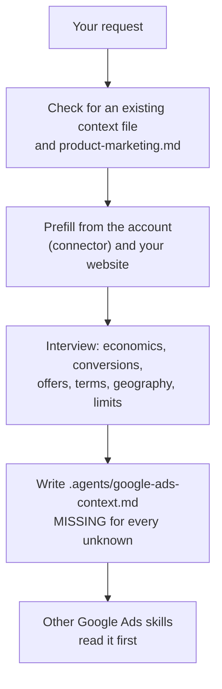

# Google Ads Account Context | Set Up the Business Context Claude Needs Before It Manages Your Google Ads

**Skill folder:** [`google-ads/google-ads-account-context/`](../../google-ads/google-ads-account-context/)

This skill builds one short file that tells Claude what your Google Ads account can't: what your business can honestly claim in an ad, what a conversion is worth, which conversion actions are real, which search terms must never be blocked, and what Claude may change without asking. Say *"set up my Google Ads context"*. Claude pulls what it can from your account and website, interviews you for the rest, and saves `.agents/google-ads-context.md`. Every other skill in the [Google Ads area](../../google-ads/) reads that file before it analyzes, writes, or changes anything.

Without this file, an AI working on your ads has to guess your target CPA, assumes every "conversion" is a sale, and makes up offers like "20% off" because ads usually have one. With it, Claude works from your real numbers and your approved claims, and it marks anything it doesn't know as MISSING instead of filling the gap.

---

## What it's used for

- **Onboarding a new account.** Capture targets, conversion definitions, campaign purposes, and rules once, instead of re-explaining them in every chat.
- **Keeping ad copy honest.** Ads draw only on the offers, prices, and proof points you've approved, each with its source and expiry date.
- **Protecting what matters.** A protected-terms list (your brand, product names, core services) that negative keywords are checked against before anything goes live.
- **Setting the guardrails.** Who approves changes, and how big a budget or target change can be in one batch.
- **Explaining results later.** A dated changelog of target, offer, and tracking changes, so a jump in CPA can be traced to "we changed the target on the 3rd".

## At a glance

| | |
|---|---|
| **Area** | [Google Ads](../../google-ads/) |
| **Works in** | Claude (web and desktop apps), Claude Code, the Claude API, and other agents that support Agent Skills |
| **Use it by** | Asking in plain English, such as *"set up my Google Ads context"* or *"update my target CPA to $75"*, or naming the skill |
| **You provide** | Answers to a short interview: targets, what each conversion means, approved offers, protected terms, and limits |
| **You get** | `.agents/google-ads-context.md`, or a file to download when there's no project folder |
| **Tools it uses** | A Google Ads connector and your website, both optional, to prefill the file |
| **Version** | 1.0.0 |

---

## How it works



### Step 1: Check what already exists

Claude looks for an existing context file. If it finds one, it reports the version, the last update, and every item still marked MISSING, then asks which sections you want to change. It also looks for `.agents/product-marketing.md`, the context file from the [marketingskills](https://github.com/coreyhaines31/marketingskills) product-marketing skill. If that file exists, Claude reuses your product, audience, proof, and voice instead of asking again.

### Step 2: Prefill from your account and website

With a Google Ads connector, Claude pulls your account basics (currency, time zone, auto-tagging), campaigns with their types, bid strategies, and budgets, and every conversion action with its settings. It also checks which conversion actions fired in the last 90 days, because an enabled action that never fires is worth asking about. It reads your homepage and main landing pages for offers, prices, and proof points, and marks each one "seen on site, confirm", because a website can claim things an ad can't.

### Step 3: Interview for the rest

Claude asks in short batches, one section at a time:

| Section | What Claude asks |
|---|---|
| Economics | Target CPA or ROAS, the break-even point, margin, monthly budget and acceptable daily swing |
| Conversions | What each action really measures, whether it should drive bidding, its value, known problems, and how long conversions take to arrive |
| Offer and proof | Which offers, prices, guarantees, and proof points are approved, and when they expire |
| Terms | Protected terms, services you don't offer, and your competitor policy |
| Geography | Where you serve, what to exclude, and hours if calls matter |
| Permissions | What needs approval, who approves, and the largest budget and target changes per batch |

If you don't know an answer, it goes in as MISSING. Claude never fills a gap with an industry benchmark.

### Step 4: Write and version the file

The file follows a fixed template, because other skills read sections by name. The change validator in [google-ads-apply-changes](google-ads-apply-changes.md), for example, reads the Protected terms list and the "Max ..." limit lines. Each update bumps the version and adds a changelog line saying what changed and why.

### What's in the skill folder

| File | What it holds | When Claude reads it |
|---|---|---|
| `SKILL.md` | The steps: check, prefill, interview, write, version | Every time the skill runs |
| `references/context-template.md` | The context file template with every section and hint | When writing or updating the file |
| `references/prefill-queries.md` | GAQL queries for account basics, campaigns, and conversion actions | When a Google Ads connector is available |

---

## Setup

Plan on about 20 minutes, most of it answering questions.

### 1. Install the skill

**Claude (web and desktop apps):** Download this repo (**Code → Download ZIP**), unzip it, and zip the `google-ads/google-ads-account-context` folder on its own. In Claude, go to **Customize → Skills**, click **+**, choose **Create skill → Upload a skill**, and upload the zip. Code execution must be on in **Settings → Capabilities**.

**Claude Code:** Copy the `google-ads-account-context` folder into `~/.claude/skills/` for all your projects, or into `.claude/skills/` in one project.

**Skills CLI (Claude Code, Codex, Cursor, and other agents):**

```bash
npx skills add Width-ai/claude-marketing-skills --skill google-ads-account-context --global
```

See [Installing a skill](../../README.md#installing-a-skill) for the Claude API and more options. Install the other three Google Ads skills the same way; they all read this file.

### 2. Connect Google Ads (optional)

A connector lets Claude prefill the account basics, campaigns, and conversion actions, so you only confirm them. Any Google Ads connector that can read your account works. Google's official Google Ads MCP server is free, and Google's [google-ads-api-mcp-setup skill](https://github.com/google/skills/tree/main/skills/ads/google-ads-api-mcp-setup) walks through installing it. Without a connector, Claude asks for your account ID, currency, and time zone, and the interview covers the rest.

### 3. Add a line to your AGENTS.md (optional)

If your project has an AGENTS.md or CLAUDE.md, add this line so your agent follows the rule even before the skill loads:

```markdown
- Before any Google Ads work, read `.agents/google-ads-context.md`. If it doesn't exist, create it with the google-ads-account-context skill.
```

### 4. Test it

1. Start a new chat and send: *"Set up my Google Ads context. My site is example.com."*
2. Claude reports what it found (or that it's starting fresh), prefills what it can, and starts asking about economics.
3. When it's done, open the file and check that the Conversions table lists every conversion action in your account, and that anything you didn't answer says MISSING.

### 5. Make it yours

- **Several accounts:** name each file `.agents/google-ads-context-<customer-id>.md` and tell Claude which account you're working on.
- **Your own sections:** add sections at the end, such as "Approved landing pages" or "Legal review notes". Keep the existing section names as they are.
- **Tighter limits:** lower the "Max ..." lines under Permissions and limits. The change validator enforces whatever numbers are there.

---

## Using it

| Ask for | What you get |
|---|---|
| *"Set up my Google Ads context"* | Prefill, interview, and a new context file |
| *"Our target CPA is now $75 because margins dropped"* | The Economics section updated, the version bumped, and a changelog line with the reason |
| *"Add these to protected terms: acme, acme pro, acmepro"* | The Protected terms list updated |
| *"What's still missing from my Google Ads context?"* | A list of every MISSING item and why each matters |
| *"We stopped offering free installation on Dec 1"* | The offer removed, with a dated changelog entry |

Tips for better results:

- Give the break-even number as well as the target. Other skills use break-even to decide whether a search term is failing or just hasn't had enough clicks yet.
- Describe conversion actions honestly, including the messy ones ("form fills, about a fifth are spam"). That one line changes how every later analysis reads your results.
- In a chat without a project folder, download the file at the end and attach it to future Google Ads chats, or add it to your project's files.

---

## Troubleshooting

| Symptom | Likely cause |
|---|---|
| Claude doesn't use the skill | The skill is turned off in **Customize → Skills**, or the request doesn't match its description. Name it directly: *"Use the google-ads-account-context skill to set up my account."* |
| The file disappears between chats | The chat has no project folder. Download the file and attach it next time, or add it to your project's files. |
| Prefill returns nothing | No Google Ads connector is connected, or it's pointed at a manager account. Give Claude the client account's customer ID. |
| A conversion action is missing from the table | It's paused or removed, so the prefill skipped it. Tell Claude about it if it still matters for reporting. |
| The change validator ignores your limits | A "Max ..." line was reworded or left as a bracketed hint. Keep the format `Max budget change per batch: 20%`. |
| Claude keeps asking for the same facts | Other skills can't find the file. Check it's at `.agents/google-ads-context.md` relative to the folder Claude is working in. |
