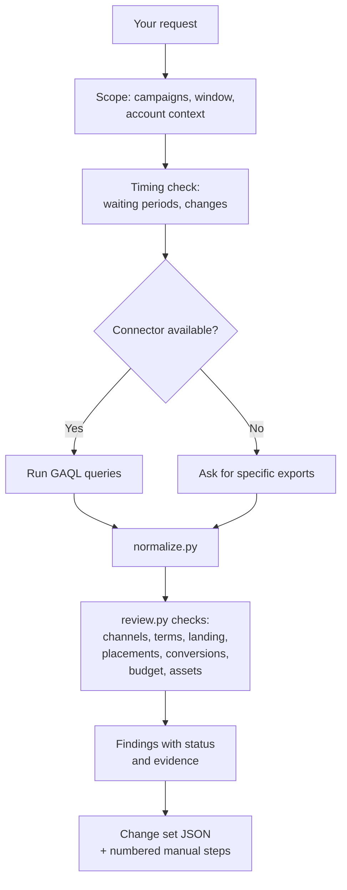

# Google Ads AI Max and Performance Max Review | Audit PMax and AI Max Spend, Brand Traffic, Search Terms, and Landing Pages with Claude

**Skill folder:** [`google-ads/google-ads-ai-max-pmax-review/`](../../google-ads/google-ads-ai-max-pmax-review/)

This skill gives you a second opinion on Google's automation. Ask something like *"review my Performance Max and AI Max campaigns for the last 4 weeks"*. Claude pulls the data through a connected Google Ads tool, or tells you exactly which CSVs to download, and checks where the spend went: which channels, which search terms, how much went to your own brand, which pages final URL expansion picked, and which apps and sites your ads showed on. You get findings with evidence, a change set for the changes your tools can make, and numbered steps for the ones you make in Google Ads yourself. Nothing is changed in your account.

Google's reports show what AI Max and Performance Max did. They don't ask whether it was good for you. This skill does: it separates brand searches you'd likely get anyway from new demand, compares AI Max matches with your own keywords inside the same campaign, checks expanded landing pages against your own pages, and refuses to judge a campaign during Google's waiting periods. Every number comes from a script, and anything it can't see is marked MISSING.

---

## What it's used for

- **Finding out what Performance Max is really buying.** Spend and conversions by channel (Search, Search partners, YouTube, Display, Discover, Gmail, Maps), with verdicts that only call a channel bad when the data proves it.
- **Measuring brand traffic.** How much of Performance Max and AI Max spend goes to searches for your own brand, what the campaign's cost per conversion looks like without them, and whether brand exclusions are set.
- **Checking AI Max after the migration.** Which searches AI Max matched beyond your keywords, how they convert against your own keywords, and where final URL expansion sent people.
- **Cleaning up inventory.** Mobile apps, made-up looking sites, and clickbait or children's videos in the Performance Max placement report, flagged for you to review.
- **Spotting weak setup.** Low-value conversion actions driving bidding, asset groups below Google's minimums, and budget-limited campaigns that now spend toward their target since August 17, 2026.

## At a glance

| | |
|---|---|
| **Area** | [Google Ads](../../google-ads/) |
| **Works in** | Claude (web and desktop apps), Claude Code, the Claude API, and other agents that support Agent Skills |
| **Use it by** | Asking in plain English, such as *"is Performance Max eating my brand traffic?"*, or naming the skill |
| **You provide** | A connected Google Ads tool or CSV exports, your brand names, and your target CPA or ROAS (ideally in an account context file) |
| **You get** | A review in the chat (and saved as a Markdown file in a project folder) with findings, evidence, and statuses; a change set JSON for google-ads-apply-changes; and numbered manual steps |
| **Tools it uses** | Code execution, a Google Ads connector that runs GAQL (optional), and web fetch or a browser to open landing pages and placements |
| **Version** | 1.0.0 |

---

## How it works



### Step 1: Scope

Claude lists your Performance Max campaigns and Search campaigns with AI Max on, with each one's bid strategy, target, budget, and status. It reads your [account context](google-ads-account-context.md) for your brand names, target and break-even CPA or ROAS, what each conversion action really measures, and the search terms you don't want.

### Step 2: Timing check

Before judging anything, Claude checks recent changes against Google's waiting periods. A campaign still inside one is marked **Too early**, with the date it can be judged fairly.

| Change | Wait before judging |
|---|---|
| AI Max turned on | About 2 weeks (Google) |
| Performance Max assets changed | 2 to 3 weeks (Google) |
| Target or bid strategy changed | 2 weeks plus your conversion delay (Google) |
| Budget changed | 7 days |
| Negatives, exclusions, other changes | 14 days |

It also flags windows split by a change, recent days still missing conversions, comparisons across the August 17, 2026 bidding change, and Performance Max channel data before June 1, 2025 (when Google's channel split begins).

### Step 3: Pull the data

With a connector, Claude runs the bundled queries. Each one is marked as confirmed against Google's API documentation or "check with the metadata tool", so renamed fields get caught instead of silently returning nothing. Without a connector, Claude asks for specific downloads from the Google Ads web interface. Everything is cleaned into standard tables.

### Step 4: Run the checks

| Area | What it looks at |
|---|---|
| Where the spend went | Cost and conversion share by channel, with a verdict per channel |
| Search terms | Share that's brand, competitor, irrelevant, or identical to an exact keyword in your Search campaigns; AI Max matches against your own keywords; search themes that repeat keywords |
| Brand traffic | Brand share of spend and conversions, cost per conversion with and without brand, brand exclusions in place |
| Landing pages | Share of clicks and cost on pages Google chose, and how they convert against your pages |
| Placements | Apps, odd-looking domains, and clickbait or children's videos (impressions only) |
| Conversion quality | Which conversion actions make up each campaign's conversions |
| Budget and targets | Spend against budget, campaign target against your target and break-even |
| Asset coverage | Asset counts per asset group against Google's minimums, and Google-created assets |

A verdict only says "worse than target" when the data rules out hitting the target. Otherwise it says "not conclusive yet" or "not enough data".

### Step 5: Recommend

Only real issues get a recommendation, and each goes the safest route available:

| Change | Route |
|---|---|
| Negatives on AI Max Search campaigns, budgets, targets, pauses | A change set for [google-ads-apply-changes](google-ads-apply-changes.md), which previews, validates, and applies after your approval |
| Brand exclusions, URL exclusions, final URL expansion off, Performance Max negatives, placement exclusions, search themes, assets, conversion goals | Numbered steps for the Google Ads interface |

### What's in the skill folder

| File | What it holds | When Claude reads it |
|---|---|---|
| `SKILL.md` | The rules, the five steps, and the report format | Every time the skill runs |
| `references/queries.md` | GAQL queries for every dataset, each marked confirmed or "check with the metadata tool" | When pulling through a connector |
| `references/exports.md` | Download steps for the Google Ads web interface, and which settings to read out | When there's no connector |
| `references/review-checks.md` | How to judge each area, the statuses, and how to write a finding | Before judging anything |
| `references/recommendations.md` | Which changes go into the change set, and the manual steps for the rest | When recommending |
| `references/platform-facts.md` | Dated facts on AI Max, Performance Max, bidding, and the API, with sources | When a fact may have changed |
| `scripts/normalize.py` | Cleans connector results and CSV downloads into standard tables (same as in google-ads-data-pull) | On every raw file |
| `scripts/metrics.py` | Totals, comparisons, search term coverage, and zero-conversion math (same as in google-ads-data-pull) | For coverage and extra summaries |
| `scripts/review.py` | The eight checks: timing, channels, terms, landing, placements, conversions, budget, assets | For every check |

---

## Setup

Plan on about 15 minutes, plus connector setup if you want one.

### 1. Install the skill

**Claude (web and desktop apps):** Download this repo (**Code → Download ZIP**), unzip it, and zip the `google-ads/google-ads-ai-max-pmax-review` folder on its own. In Claude, go to **Customize → Skills**, click **+**, choose **Create skill → Upload a skill**, and upload the zip. Code execution must be on in **Settings → Capabilities**, because the skill runs Python scripts.

**Claude Code:** Copy the `google-ads-ai-max-pmax-review` folder into `~/.claude/skills/` for all your projects, or into `.claude/skills/` in one project.

**Skills CLI (Claude Code, Codex, Cursor, and other agents):**

```bash
npx skills add Width-ai/claude-marketing-skills --skill google-ads-ai-max-pmax-review --global
```

See [Installing a skill](../../README.md#installing-a-skill) for the Claude API and more options. This skill works on its own, and works best with [google-ads-account-context](google-ads-account-context.md) for your business facts and [google-ads-apply-changes](google-ads-apply-changes.md) to apply the change set.

### 2. Connect Google Ads (optional)

- **Google's official Google Ads MCP server** runs any GAQL query, which covers every dataset this review uses. Google's [google-ads-api-mcp-setup skill](https://github.com/google/skills/tree/main/skills/ads/google-ads-api-mcp-setup) walks through setup. Since September 2026, Google Ads API access no longer needs a developer token.
- **Third-party Google Ads connectors** work too. Claude uses whichever reports they offer and marks what they don't cover as MISSING.

Without a connector, the skill works from CSV downloads and asks you to read a few settings out (AI Max, final URL expansion, brand exclusions).

### 3. Add your business details

Run [google-ads-account-context](google-ads-account-context.md) once. The review uses its brand terms, target and break-even CPA or ROAS, conversion definitions, unwanted terms, competitor policy, and change limits. Without it, Claude asks for your brand names and misspellings, your target, and the searches you don't want, in one message.

### 4. Add a line to your AGENTS.md (optional)

If your project has an AGENTS.md or CLAUDE.md, add this line so your agent follows the rule even before the skill loads:

```markdown
- Review Performance Max and AI Max with the google-ads-ai-max-pmax-review skill, and never judge a campaign inside Google's waiting period after a change.
```

### 5. Test it

1. Start a new chat and send: *"Review my Performance Max campaign for the last 28 days. Our brand is Acme, sometimes spelled Akme, and our brand campaign is Search - Brand."*
2. Claude confirms the campaigns and window, checks recent changes, and pulls the data (or lists the downloads it needs). A full review takes a few minutes.
3. Check the data notes: they should state the share of search term clicks Google disclosed, and every share in the brand finding should say it's a share of disclosed traffic.

### 6. Make it yours

- **Landing page patterns:** pass `--review-patterns` with the URL words that should never get paid clicks on your site, such as `careers,login,investors`.
- **Safe domains for placements:** add your country's domain ending with `--extra-tlds co.uk` (or `ca`, `com.au`), so local sites aren't flagged.
- **Low-value conversions:** list them in the account context's Conversions table, and Claude passes them to the conversion check.

---

## Using it

| Ask for | What you get |
|---|---|
| *"Where is my Performance Max spend actually going?"* | Spend and conversions by channel, with a verdict per channel and the share Google doesn't split |
| *"Is PMax eating our brand traffic?"* | Brand share of spend and conversions, cost per conversion without brand, and whether brand exclusions are set |
| *"What is AI Max matching in Search - Services?"* | AI Max matches against your keywords, irrelevant and competitor terms, and proposed negatives with evidence |
| *"Which pages is final URL expansion sending people to?"* | Expanded pages with clicks, cost, and conversion rate against your own pages, after Claude opens the top ones |
| *"Check my PMax placements for junk"* | Flagged apps, sites, and videos to review, with impressions, and steps to exclude the ones you approve |
| *"Here are my exports, review PMax and AI Max"* | The same review from your files, with settings it couldn't see marked Unknown |

Tips for better results:

- Name your brand campaign. Brand searches there are expected; brand searches in Performance Max are the finding.
- Say when AI Max was turned on, especially if it came with the September 2026 migration. It decides whether the campaign can be judged yet.
- Review terms Claude labels as irrelevant before it reruns the numbers. It asks, because your offer may cover searches that sound off.
- After you make changes, ask for the review again after the review dates. Comparing equal windows shows whether each change worked.

---

## Troubleshooting

| Symptom | Likely cause |
|---|---|
| Claude doesn't use the skill | The skill is turned off in **Customize → Skills**, or the request doesn't match its description. Name it directly: *"Use the google-ads-ai-max-pmax-review skill to ..."* |
| Everything says "not enough data" | The window is short or the account is small. Claude says how many clicks would settle each question; use a longer window if nothing changed in it. |
| A campaign is marked Too early | A recent change (AI Max on, assets, target) is inside Google's waiting period. The review shows the date it can be judged. |
| No channel split for Performance Max | Channel data only exists from June 1, 2025, and needs a recent API version or the Channel performance page. Older data shows as cross-network. |
| Brand exclusions show as Unknown | The connector couldn't read brand lists, or you're on exports. Tell Claude which brand lists are attached, or send a screenshot of the campaign's brand exclusions. |
| Placements have no cost | That's expected. Google's placement report has impressions only. Cost by channel comes from the channel check. |
| The script refuses the search terms files | Two files covered the same campaign, or the AI Max combination view was mixed with the search terms report. Both would count the same traffic twice. |
| `UNRECOGNIZED_FIELD` errors | A field was renamed or isn't selectable. Claude should check it with the connector's metadata tool, and mark that part MISSING if it can't be fixed. |
| Scripts don't run in Claude | Code execution is off. Turn it on in **Settings → Capabilities**. |
