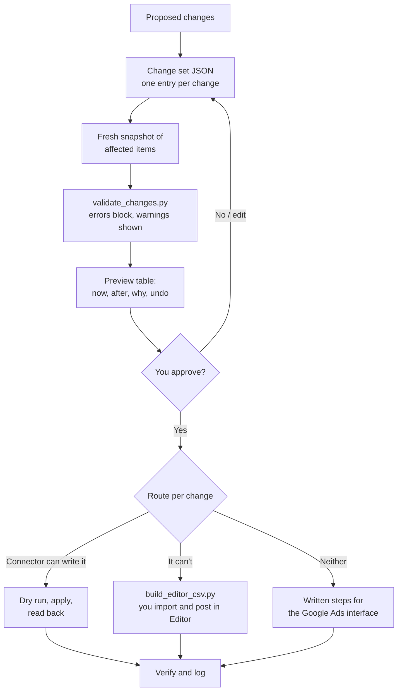

# Google Ads Apply Changes | Make Safe, Approved Google Ads Changes with Claude, through a Connector or Google Ads Editor

**Skill folder:** [`google-ads/google-ads-apply-changes/`](../../google-ads/google-ads-apply-changes/)

This skill is how changes get into your Google Ads account: negative keywords, new keywords, pauses, budgets, bids, CPA and ROAS targets, and new responsive search ads. Say *"add these negatives and raise the Brand budget to $60"*. Claude writes the changes into one batch and checks them against your live account and your rules. It shows a before and after preview, waits for your approval, and then applies the batch. If your connected Google Ads tool can make the change, it applies it there. If not, it builds Google Ads Editor import files with rollback files.

The checks catch the mistakes that cost real money. A misspelled campaign name in an Editor import quietly creates a new campaign. A negative keyword can block your best-converting search. A budget doubled when you meant a small step overspends for days. A "current value" that changed since the analysis was done gets overwritten. Nothing is applied until you've seen it, and nothing is ever deleted.

---

## What it's used for

- **Rolling out search term cleanups.** Add negatives at the campaign or ad group level, after a check that none would block a live keyword or a converting search.
- **Budget and target changes within limits.** Moves larger than your set limits (20% for budgets and 15% for targets by default) need you to approve that specific line.
- **Pausing what isn't working.** Pause keywords, ad groups, or campaigns, with the previous status recorded so it can be undone.
- **Launching new ads safely.** New responsive search ads are checked against Google's text limits and common disapproval triggers, and created paused.
- **Working in any setup.** Applies through a write-capable connector when there is one, builds Editor files when there isn't, and writes step-by-step instructions for anything neither can do.

## At a glance

| | |
|---|---|
| **Area** | [Google Ads](../../google-ads/) |
| **Works in** | Claude (web and desktop apps), Claude Code, the Claude API, and other agents that support Agent Skills |
| **Use it by** | Asking in plain English, such as *"apply these changes"*, *"add these negatives"*, or *"pause these keywords"*, or naming the skill |
| **You provide** | The changes (or a list from another skill), approval of the preview, and a current snapshot of the items being changed |
| **You get** | A preview table, then either applied changes read back from the account, or Editor import files with a manifest and rollback files |
| **Tools it uses** | Code execution, a Google Ads connector (optional, for snapshots and writes), and Google Ads Editor (for import files) |
| **Version** | 1.0.0 |

---

## How it works



### Step 1: Gather the batch

Every change becomes one entry in a JSON change set: the action, the exact campaign and ad group, the current value, the new value, the reason, and the evidence. Requests in plain words ("pause the bad ones") are turned into explicit entries and shown back to you, never guessed.

### Step 2: Check against the account

Claude takes a fresh snapshot of the items being changed and runs the validator:

| Check | Result |
|---|---|
| Campaign or ad group name not found in the account | Error. Prevents an Editor import from creating a new campaign or ad group by accident. |
| Current value differs from the change set's "from" value | Error. Someone changed it since the analysis. |
| Budget or target change larger than your limit | Error, unless you approve that line |
| Deletes, missing fields, duplicates, retired "+" match modifiers | Error |
| Headlines over 30 characters, descriptions over 90, paths over 15, duplicate assets | Error. Wide characters count double, as Google counts them. |
| Negative would block a live keyword | Warning |
| Negative would block a search term that converted | Warning, with the terms and conversions listed |
| Negative touches a protected term from your account context | Warning |
| Ad text with repeated punctuation, emoji, all caps, phone numbers, or exclamation marks in headlines | Warning |

The validator also prints a review date for each change, based on how long Google says to wait before judging that kind of change.

### Step 3: Preview and approval

You see one table, grouped by campaign: what changes, its current and new value, why, and how to undo it. Under it are the spend affected, the warnings, and how each change will be applied. Whenever something new is being created, Claude spells out whether it's a campaign or an ad group, because mixing those up is the most expensive mistake an agent can make. You approve the batch, approve it with edits, or reject it. Rejected lines stay in the file, marked as not approved.

### Step 4: Apply

| Route | When |
|---|---|
| Connector write | Your connected tool can make this type of change. Claude dry-runs first if the tool supports it, applies in small groups, and reads each change back. |
| Google Ads Editor files | No connected tool can make it. Google's official Google Ads MCP server, for example, can't change keywords, negatives, budgets, or bids. |
| Written steps | Neither route supports it, such as bid strategy type or AI Max settings |

Editor files come one per change type, so each holds only the columns it needs: negatives, keywords, keyword bids, statuses, budgets, and ads. They come with a manifest giving the import order, and rollback files where Editor can express the undo.

### Step 5: Verify and log

Every change is read back from the account, or confirmed by you after posting from Editor. Then it's written to the change log with its reason and review date.

### What's in the skill folder

| File | What it holds | When Claude reads it |
|---|---|---|
| `SKILL.md` | The rules and the six steps | Every time the skill runs |
| `references/change-set-format.md` | The change set JSON format, every action, and the change log columns | When writing a batch or logging |
| `references/connector-writes.md` | How to check a connector's write tools, what Google's official server can and can't do, and how to apply and recover safely | When applying through a connector |
| `references/editor-import.md` | What each Editor file contains, header troubleshooting, and the import steps to give you | When building Editor files |
| `scripts/validate_changes.py` | The checks above | Before every preview |
| `scripts/build_editor_csv.py` | Builds the Editor files, manifest, and rollback files | When a change goes through Editor |

---

## Setup

Plan on about 15 minutes, plus installing Google Ads Editor if you'll use import files.

### 1. Install the skill

**Claude (web and desktop apps):** Download this repo (**Code → Download ZIP**), unzip it, and zip the `google-ads/google-ads-apply-changes` folder on its own. In Claude, go to **Customize → Skills**, click **+**, choose **Create skill → Upload a skill**, and upload the zip. Code execution must be on in **Settings → Capabilities**.

**Claude Code:** Copy the `google-ads-apply-changes` folder into `~/.claude/skills/` for all your projects, or into `.claude/skills/` in one project.

**Skills CLI (Claude Code, Codex, Cursor, and other agents):**

```bash
npx skills add Width-ai/claude-marketing-skills --skill google-ads-apply-changes --global
```

See [Installing a skill](../../README.md#installing-a-skill) for the Claude API and more options. This skill works best with [google-ads-data-pull](google-ads-data-pull.md) for snapshots and [google-ads-change-log](google-ads-change-log.md) for the record.

### 2. Connect tools

- **A Google Ads connector that reads** (optional, recommended): fresh snapshots straight from the account. Google's official Google Ads MCP server works for this.
- **A connector that writes** (optional): lets Claude apply changes directly. Check what it supports. Google's official server writes only assets and labels. Third-party connectors vary, and some apply changes the moment they're called.
- **Google Ads Editor** (free from Google): needed for import files. Install it and download your account once.

### 3. Add your business details

Run [google-ads-account-context](google-ads-account-context.md) so the validator knows your protected terms and limits. Without it, the skill uses default limits (20% for budgets, 15% for targets, 50 changes per batch) and can't check protected terms.

### 4. Add a line to your AGENTS.md (optional)

If your project has an AGENTS.md or CLAUDE.md, add this line so your agent follows the rule even before the skill loads:

```markdown
- Never change the Google Ads account without my approval of the exact batch. Make changes through the google-ads-apply-changes skill, and pause instead of deleting.
```

### 5. Test it

1. Start a new chat and send: *"Add 'jobs' as a broad negative to my Search campaign, and show me the preview first."*
2. Claude pulls a snapshot (or asks for a keyword and search terms export), writes a one-line change set, runs the validator, and shows the preview with the review date. Nothing is applied yet.
3. Check that the preview names the exact campaign and says how the change will be applied. Then approve it, or say no to end the test.

### 6. Make it yours

- **Your own limits:** set them in the account context's Permissions and limits section. The validator reads them every time.
- **Header spellings for your Editor:** if your Editor labels columns differently, export a small sample and have Claude rebuild with `--template sample.csv`.
- **UTF-8 files:** if your setup prefers comma-separated UTF-8, ask for `--utf8`.

---

## Using it

| Ask for | What you get |
|---|---|
| *"Apply the negatives from the search term review"* | A validated batch, a preview with any terms that converted flagged, then Editor files or connector writes |
| *"Raise Brand's budget from $50 to $60"* | A one-line preview (a 20% change, inside the default limit), then the change applied and logged |
| *"Double the budget on Services"* | An error saying it's past the limit, with an offer to split it into steps or have you approve the larger move |
| *"Pause these five keywords"* | A preview listing each keyword, its match type, and its current status, plus rollback files |
| *"Upload this ad to the Plumbing ad group"* | Character-count and policy checks, the ad created paused, and a reminder to enable it when ready |
| *"Change the target CPA to $70"* | Written steps or a connector change, since Editor files don't cover targets |

Tips for better results:

- Include the reason with every change ("job seekers, 61 clicks, no conversions"). It goes into the change log, and it's what you'll want to know in three months.
- Give a fresh export or let the connector pull right before applying. A snapshot from last week can approve a change against values that no longer exist.
- In Editor, review the pending changes before posting. A new campaign you didn't expect means a name didn't match.

---

## Troubleshooting

| Symptom | Likely cause |
|---|---|
| Claude doesn't use the skill | The skill is turned off in **Customize → Skills**, or the request doesn't match its description. Name it directly: *"Use the google-ads-apply-changes skill to ..."* |
| "not found in the snapshot" error | The campaign or ad group name doesn't exactly match the account, or the snapshot didn't include it. Check spelling, spacing, and dashes. |
| "status is now X, not Y" error | The account changed after the analysis. Re-pull, then rebuild the batch. |
| The Editor import preview doesn't recognize a column | Your Editor uses a different header spelling. Export a sample and rebuild with `--template`. |
| Editor shows garbled characters | The file was opened and re-saved in a spreadsheet app. Import the original file, or rebuild with `--utf8`. |
| A new campaign appeared after the Editor import | A name didn't match an existing campaign. Revert it in Editor before posting. The validator catches this when it has a snapshot. |
| The builder refuses to run | The change set has no `approved_by`. Approve the batch first, or pass `--include-unapproved` to build a draft for review. |
| A connector write timed out | Claude reads the item back before retrying. If it doesn't, ask it to check the item's current state first. |
