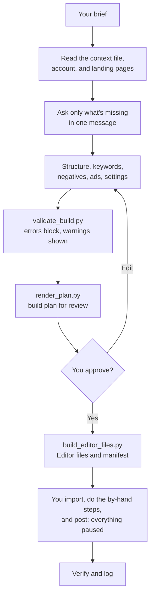

# Google Ads Campaign Builder | Build a New Google Ads Search Campaign from a Brief with Claude, Ready for Google Ads Editor

**Skill folder:** [`google-ads/google-ads-campaign-builder/`](../../google-ads/google-ads-campaign-builder/)

This skill turns a brief into a complete new Search campaign: themed ad groups, keywords and match types, starting negatives, responsive search ads, sitelinks, callouts, and every campaign setting, all created paused. Say *"build a Search campaign for our water heater installs in Richmond, $1,200 a month"*. Claude reads your account context and landing pages, asks only for what's missing, and shows you a build plan with every setting explained and every ad line counted and sourced. After you approve it, you get Google Ads Editor import files that create the campaign. It needs no paid connector: Editor is free, and a Google Ads connector is optional, used only to read.

What you get that a plain request wouldn't give you: ads that only claim what you've approved (a script checks every number against its source), search volumes that come from Keyword Planner or a keyword tool or say MISSING, settings that match how Google Ads works in late 2026 (AI Max starts on in new campaigns, language targeting is gone from Search), and a check that the new campaign's name doesn't match one you already have, which would make an Editor import change that campaign instead.

---

## What it's used for

- **Launching a new service or location.** Go from "we want leads for tankless installs in Chesterfield" to a reviewed, paused campaign in Editor, without building it by hand.
- **Rebuilding a messy campaign cleanly.** Plan a fresh, themed structure with sourced copy and current settings, then run it alongside or instead of the old one.
- **Getting a second opinion on structure.** See how keywords group into ad groups, which match types to start with, and why, before anything is built.
- **Working without paid tools.** Keyword ideas come from a free Keyword Planner export, your own terms, and your site; the campaign arrives through a free Editor import.
- **Keeping ads honest.** Every claim traces to an approved offer or proof point in your context file, or to something you confirmed in the chat.

## At a glance

| | |
|---|---|
| **Area** | [Google Ads](../../google-ads/) |
| **Works in** | Claude (web and desktop apps), Claude Code, the Claude API, and other agents that support Agent Skills |
| **Use it by** | Asking in plain English, such as *"build a new Search campaign from this brief"*, or naming the skill |
| **You provide** | The brief (service, budget, area), your landing pages, approval of the plan, and ideally a Keyword Planner export and a Google Ads Editor export of your account |
| **You get** | A build plan in Markdown, then Google Ads Editor import files with a manifest and a rollback file, and a change log entry |
| **Tools it uses** | Code execution, web access to read your landing pages, Google Ads Editor (free), and a Google Ads connector (optional, read only) |
| **Version** | 1.0.0 |

---

## How it works



### Step 1: Gather the brief

Claude reads `.agents/google-ads-context.md` first: your approved offers and proof points, budget, conversion actions, existing campaigns, protected terms, terms you don't want, competitor policy, service area, and copy rules. With a connector, it reads your campaign names, conversion actions (and whether they fired recently), live keywords, and currency and time zone. Without one, it asks for an Editor export. It reads your landing pages and marks any claim it finds there "confirm". Then it asks for the rest in one message, such as the budget for this campaign, whether you want AI Max on, and the EU political ads declaration Google requires on every new campaign.

### Step 2: Structure and keywords

One build makes one campaign. Brand, non-brand, competitor terms, and services with different economics get separate campaigns. Inside, each ad group has one theme: if one ad can't answer every keyword, the group gets split. Keywords come from your account history, a Keyword Planner export, your own words, your site, and web research, cleaned by `keyword_list.py`.

| Choice | Default | Why |
|---|---|---|
| Match types | Phrase for every keyword, plus exact for core terms | An exact keyword identical to the search wins over broad, AI Max, and Performance Max. Broad waits until there are steady conversions and Smart Bidding. |
| Search volumes | As reported by Keyword Planner or a keyword tool, else MISSING | Never estimated |
| Negatives | Your "Terms we don't want", what you add, and routing between ad groups | No generic starter lists: a loose "free" negative blocks "free estimate" |

### Step 3: Ads, assets, and settings

Two responsive search ads per ad group, up to 15 headlines and 4 descriptions each, 6 sitelinks, and 4 or more callouts. Any line with a number, price, rating, guarantee, "free", "best", or similar cites a source, and every number must appear in that source.

| Setting | Default | Why |
|---|---|---|
| Networks | Google Search only | Search partners and Display are off; Display left on in a Search campaign is a mistake auditors find often |
| Location option | Presence | Reaches people in or regularly in your area, not people elsewhere who are only interested in it |
| Languages | Not set | Google removed campaign language targeting from Search in late September 2026 |
| Bid strategy | By tracking and conversion volume | Usually Maximize conversions with no target for a new campaign; never Smart Bidding on unchecked tracking |
| AI Max | Off at launch, unless you choose it | New Search campaigns start with AI Max on; it can send traffic to pages you didn't pick |
| Status | Paused, everything | Launching is a separate yes |

### Step 4: Check, plan, approve

`validate_build.py` checks the whole build:

| Check | Result |
|---|---|
| Campaign name matches one already in the account | Error. An Editor import would change that campaign. |
| Anything not paused, retired features (Enhanced CPC, broad match modifier, expanded text ads, call-only ads, Dynamic Search Ads, language targeting) | Error |
| Text over Google's limits (headlines 30, descriptions 90, paths 15, sitelinks 25 and 35, callouts 25), or more than 3 ads in an ad group | Error |
| A claim with no source, or a number its source doesn't contain | Error |
| A volume with no source, or one that doesn't match the keyword file | Error |
| A negative that would block a planned keyword | Error |
| Smart Bidding without working tracking, or a missing AI Max decision or EU declaration | Error |
| Search partners or Display on, broad match, thin ads or assets, protected terms, overlap with your live keywords, words you avoid, likely disapprovals | Warning |

`render_plan.py` turns it into one document: what gets created ("1 new Search campaign with 3 ad groups inside it, not 3 campaigns"), each setting with its reason, budget math, every keyword with its volume or MISSING, every ad line with its character count and source, and the steps you'll do by hand in Editor.

### Step 5: Editor files, import, and verify

After you approve, `build_editor_files.py` writes one file per item type (campaign, locations, ad groups, keywords, negatives, ads, sitelinks, callouts), a manifest with the import order and what Editor should show after each import, and a rollback file that pauses the campaign. A few settings Google doesn't document for import (the location option, the EU declaration, AI Max) become short by-hand steps in Editor, unless your own Editor export shows the exact column and value. After you post, Claude reads the campaign back and logs it.

### What's in the skill folder

| File | What it holds | When Claude reads it |
|---|---|---|
| `SKILL.md` | The rules and the nine steps | Every time the skill runs |
| `references/brief-interview.md` | What to collect, the read-only account queries, and the one-message question list | Gathering the brief |
| `references/structure-and-keywords.md` | Campaign and ad group rules, keyword research without paid tools, match types, starting negatives | Planning and keyword work |
| `references/ads-and-assets.md` | Ad and asset limits, what to write, and the claims-and-sources rule | Writing ads, sitelinks, and callouts |
| `references/settings.md` | Every setting's default and reason, the bid strategy table, budget math, AI Max, dated platform facts | Choosing settings |
| `references/build-spec.md` | The build file format | Writing the build |
| `references/editor-import.md` | The Editor files, which columns are confirmed, import steps, verification, logging | Building files and after posting |
| `scripts/keyword_list.py` | Cleans and deduplicates keyword candidates, copying reported volumes exactly | Keyword work |
| `scripts/validate_build.py` | The checks above | Before every plan |
| `scripts/render_plan.py` | Writes the build plan | For your review |
| `scripts/build_editor_files.py` | Writes the Editor files, manifest, rollback file, and change set | After approval |

---

## Setup

Plan on about 20 minutes, plus installing Google Ads Editor if you don't have it.

### 1. Install the skill

**Claude (web and desktop apps):** Download this repo (**Code → Download ZIP**), unzip it, and zip the `google-ads/google-ads-campaign-builder` folder on its own. In Claude, go to **Customize → Skills**, click **+**, choose **Create skill → Upload a skill**, and upload the zip. Code execution must be on in **Settings → Capabilities**.

**Claude Code:** Copy the `google-ads-campaign-builder` folder into `~/.claude/skills/` for all your projects, or into `.claude/skills/` in one project.

**Skills CLI (Claude Code, Codex, Cursor, and other agents):**

```bash
npx skills add Width-ai/claude-marketing-skills --skill google-ads-campaign-builder --global
```

See [Installing a skill](../../README.md#installing-a-skill) for the Claude API and more options. It works on its own, and works best with [google-ads-account-context](google-ads-account-context.md) for your approved claims and [google-ads-change-log](google-ads-change-log.md) for the record.

### 2. Connect tools

- **Google Ads Editor** (free from Google): needed to import the files. Install it and download your account once.
- **A Google Ads connector** (optional): lets Claude read your campaign names, conversion actions, currency, and time zone directly. Google's official Google Ads MCP server works for this. The skill never uses a connector to write.
- **Without a connector:** export your account from Editor (**Account > Export > Export whole account**, CSV) and attach it. Claude uses it to check names and copy your Editor's exact column spellings.

### 3. Add your business details

Run [google-ads-account-context](google-ads-account-context.md) first if you haven't. The ads can only use offers and proof points from that file or ones you approve in the chat, so the more complete it is, the stronger the ads. For keyword volumes, export ideas from Keyword Planner (**Tools > Planning > Keyword Planner > Discover new keywords**, then **Download keyword ideas**) for your main service terms and area, and attach the file.

### 4. Add a line to your AGENTS.md (optional)

If your project has an AGENTS.md or CLAUDE.md, add this line so your agent follows the rule even before the skill loads:

```markdown
- Build new Google Ads campaigns with the google-ads-campaign-builder skill: show me the plan first, create everything paused, and never invent claims or search volumes.
```

### 5. Test it

1. Start a new chat and send: *"Build a new Search campaign for drain cleaning in our service area, $20 a day. Show me the plan first."*
2. Claude reads your context file and pages, asks a few questions in one message (such as AI Max and the EU political ads declaration), and shows a build plan. Expect 10 to 20 minutes for the back and forth. Nothing is built yet.
3. Check that the plan says "1 new Search campaign", that every claim in the ads has a source, and that volumes you didn't provide say MISSING. Approve it to get the Editor files, or say no to end the test.

### 6. Make it yours

- **Your naming convention:** put it in the Campaign map section of your context file; the build follows it.
- **AI Max on by default:** tell Claude at the start of a build, or edit the default in `references/settings.md`.
- **Your Editor's column spellings:** attach a small Editor export and Claude rebuilds with `--template`, which also lets it set the location option and other settings directly when your export shows them.
- **UTF-8 files:** if your setup prefers comma-separated UTF-8, ask for `--utf8`.

---

## Using it

| Ask for | What you get |
|---|---|
| *"Build a Search campaign for tankless water heater installs in Chesterfield, $40 a day"* | The interview, a build plan, and after approval, Editor files |
| *"Here's my Keyword Planner export, group these into ad groups"* | Cleaned keywords with reported volumes, grouped by theme, with match types and the reasons |
| *"Plan a brand campaign and a services campaign"* | Two builds, one per campaign, each with its own plan and files |
| *"Use the 4.8 star rating and the $75 tankless offer in the ads"* | Ads citing those exact sources, with the offer's end date checked |
| *"Turn AI Max on for this one"* | AI Max recorded as on, with the trade-offs, URL exclusions to set, and a check in Editor |
| *"Make the files a draft so I can look in Editor first"* | Draft files marked not approved, not to be posted |

Tips for better results:

- Give a budget and the one action that counts (a booked visit, a call, a sale). They decide the bid strategy and how the campaign is judged.
- Attach a Keyword Planner export. Without it, keywords still come from your words, site, and history, but volumes say MISSING.
- Confirm or reject claims Claude found on your site. Unconfirmed ones block the Editor files.
- Import the files in the manifest's order, and do the by-hand steps before you post.

---

## Troubleshooting

| Symptom | Likely cause |
|---|---|
| Claude doesn't use the skill | The skill is turned off in **Customize → Skills**, or the request doesn't match its description. Name it directly: *"Use the google-ads-campaign-builder skill to build ..."* |
| "already exists in the account" error | The campaign name matches one you have. Pick a new name; an Editor import would otherwise change the existing campaign. |
| "makes a claim with no source" error | An ad line has a number, price, rating, or a word like "free" or "best" without an approved source. Approve the claim, or Claude rewords the line. |
| The builder refuses to write files | The plan isn't approved yet, a claim from your website isn't confirmed, or the build has validation errors. |
| Editor's import preview doesn't recognize a column | Your Editor version spells it differently. Attach an Editor export and have Claude rebuild with `--template`, or pick the right column from the drop-down. |
| Editor shows a changed campaign after importing `campaign.csv` | The name matched an existing campaign. Revert the import and rename the build. |
| New ad groups appeared with default settings | A keyword or ad file was imported before the ad groups file. Revert and import in the manifest's order. |
| AI Max is on after posting | New Search campaigns start with AI Max on, and the by-hand step to turn it off was skipped. Turn it off in the campaign settings. |
| Volumes say MISSING | No Keyword Planner export or keyword tool was used. Attach an export and ask Claude to update the plan. |
