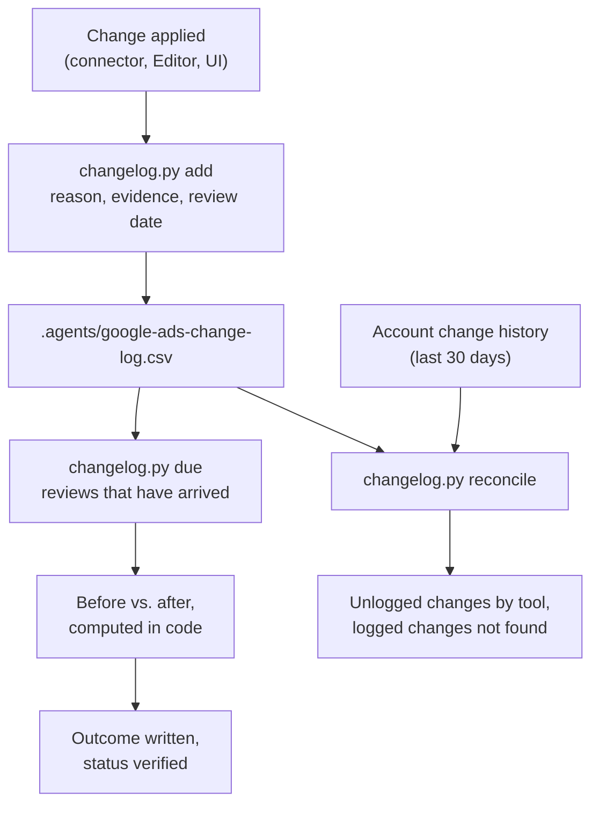

# Google Ads Change Log | Track Every Google Ads Change, Why It Was Made, and Whether It Worked

**Skill folder:** [`google-ads/google-ads-change-log/`](../../google-ads/google-ads-change-log/)

This skill keeps the record Google Ads doesn't: every change, the reason behind it, what it was expected to do, and the date to check whether it worked. Say *"which changes are due for review?"* or *"what changed in October and why?"*. Claude reads and updates a simple CSV log, lists the reviews that have come due, and summarizes any period. It also compares the log with the account's own change history, to catch changes nobody recorded: edits by other people, scripts, automated rules, and recommendations Google applied on its own.

Google Ads keeps detailed change history for only 30 days. It records what changed but never why, and the history available through the API leaves out changes posted from Google Ads Editor. So when CPA jumps in month four, nobody remembers which budget move, negative list, or target change caused it. With this log, "why did this move?" has an answer with a date and a reason.

---

## What it's used for

- **Remembering why.** Each change carries its reason, its evidence, and who approved it.
- **Checking that changes worked.** Every applied change gets a review date based on how long Google says to wait before judging it. `due` lists the reviews that have arrived.
- **Catching changes nobody logged.** Reconcile against the account's change history to see edits from the Google Ads interface, scripts, automated rules, bulk uploads, and auto-applied recommendations.
- **Explaining performance moves.** Line up changes with the dates metrics moved, and say "likely" instead of guessing.
- **Monthly client or team updates.** A summary of every change in a period, grouped by campaign, with reasons and outcomes.

## At a glance

| | |
|---|---|
| **Area** | [Google Ads](../../google-ads/) |
| **Works in** | Claude (web and desktop apps), Claude Code, the Claude API, and other agents that support Agent Skills |
| **Use it by** | Asking in plain English, such as *"log this change"*, *"what's due for review?"*, or *"what changed last month?"*, or naming the skill |
| **You provide** | Changes to record (or a change set from [google-ads-apply-changes](google-ads-apply-changes.md)), and change history from a connector or an export for reconciling |
| **You get** | `.agents/google-ads-change-log.csv`, plus Markdown tables and summaries in the chat |
| **Tools it uses** | Code execution, and a Google Ads connector for change history (optional) |
| **Version** | 1.0.0 |

---

## How it works



### Step 1: Record

`add` takes a change set from google-ads-apply-changes, or one change described by flags. Each entry gets an id, a status (proposed, approved, applied, verified, rejected, rolled back), and, once applied, a review date. If nobody knows why a change was made, the entry says "reason not recorded" and Claude asks you. It never invents a reason.

### Step 2: Review

Review dates come from Google's waiting periods where Google publishes them, and from defaults where it doesn't:

| Change | Wait before judging |
|---|---|
| Bid or target change | 14 days plus your conversion delay |
| Turning on AI Max | 14 days |
| New Performance Max assets | 21 days |
| Budget change, pause or enable | 7 days |
| Negatives, keywords, new ads | 14 days |

When a review comes due, Claude pulls equal windows before and after the change and leaves out the waiting period and late-arriving conversions. It computes the comparison in code and writes a one-line outcome with numbers and both windows. If other changes overlap, it says so, because the result can't be credited to one change.

### Step 3: Reconcile

`reconcile` compares the log with the account's change history and lists two things:

- **Changes with no log entry**, grouped by the tool that made them: the Google Ads interface, API tools, scripts, automated rules, bulk uploads, or recommendations Google applied.
- **Logged changes with no match in the history**, so you can check they really went live. Changes posted from Editor are skipped, because they never appear in that history.

Changes from recommendations get their own flag, because they usually mean auto-apply is on. Matching uses dates and the type of item changed, so treat it as a strong hint rather than proof.

### Step 4: Summarize

`summary` lists every change in a date range by campaign, with the reason, the status, and the outcome or review date. It's the basis for "what changed and why" questions and for monthly updates.

### What's in the skill folder

| File | What it holds | When Claude reads it |
|---|---|---|
| `SKILL.md` | The jobs, commands, and rules for reviews and reconciling | Every time the skill runs |
| `references/log-format.md` | Every column, every status, and how change history tools are labeled | When creating entries or reading reconcile output |
| `references/review-windows.md` | Waiting periods by change type, and where each comes from | When setting or explaining review dates |
| `scripts/changelog.py` | init, add, update, due, reconcile, and summary | For every log operation |

---

## Setup

Plan on about 5 minutes.

### 1. Install the skill

**Claude (web and desktop apps):** Download this repo (**Code → Download ZIP**), unzip it, and zip the `google-ads/google-ads-change-log` folder on its own. In Claude, go to **Customize → Skills**, click **+**, choose **Create skill → Upload a skill**, and upload the zip. Code execution must be on in **Settings → Capabilities**.

**Claude Code:** Copy the `google-ads-change-log` folder into `~/.claude/skills/` for all your projects, or into `.claude/skills/` in one project.

**Skills CLI (Claude Code, Codex, Cursor, and other agents):**

```bash
npx skills add Width-ai/claude-marketing-skills --skill google-ads-change-log --global
```

See [Installing a skill](../../README.md#installing-a-skill) for the Claude API and more options.

### 2. Connect Google Ads (optional)

Reconciling needs the account's change history. With a Google Ads connector and [google-ads-data-pull](google-ads-data-pull.md), Claude pulls it directly. Without one, export it from the Change history page in Google Ads. Either way, it only goes back 30 days, so reconcile at least monthly.

### 3. Add a line to your AGENTS.md (optional)

If your project has an AGENTS.md or CLAUDE.md, add this line so your agent follows the rule even before the skill loads:

```markdown
- Log every Google Ads change, including ones I make myself, with the google-ads-change-log skill.
```

### 4. Test it

1. Start a new chat in your project and send: *"Start a Google Ads change log, and log that I raised the Brand budget from $50 to $60 yesterday because it was losing impression share to budget."*
2. Claude creates `.agents/google-ads-change-log.csv` and adds one entry with today's log time, yesterday as the applied date, and a review date a week out.
3. Send *"What's due for review?"*. Nothing should be due yet. Open the CSV to see the entry.

### 5. Make it yours

- **Longer windows for small accounts:** ask Claude to set `--review-on` further out when the account gets too few clicks for two weeks to mean anything.
- **Several accounts:** keep one log per account, named `.agents/google-ads-change-log-<customer-id>.csv`.
- **Your own waiting periods:** edit `REVIEW_DAYS` at the top of `scripts/changelog.py` and the table in `references/review-windows.md` together.

---

## Using it

| Ask for | What you get |
|---|---|
| *"Log the batch we just applied"* | Entries from the change set, each with a review date |
| *"What's due for review?"* | A table of applied changes whose review date has arrived |
| *"Review entry 12"* | A before and after comparison with numbers and windows, and the outcome written to the log |
| *"Did anyone else change the account this month?"* | Reconcile results grouped by tool, with the ones needing reasons called out |
| *"What changed in October and why?"* | A summary by campaign with reasons and outcomes |
| *"CPA jumped on the 9th. What happened?"* | Changes lined up against the date, with "likely" causes and what the record can't see |

Tips for better results:

- Log changes you make yourself in the Google Ads interface too. Say what you changed, when, and why. Gaps in the log are where the guessing starts.
- Reconcile before the 30-day history window closes, so nothing ages out unexplained.
- Keep rejected ideas in the log (status rejected). "We tried that in March and decided against it" saves a repeat argument.

---

## Troubleshooting

| Symptom | Likely cause |
|---|---|
| Claude doesn't use the skill | The skill is turned off in **Customize → Skills**, or the request doesn't match its description. Name it directly: *"Use the google-ads-change-log skill to ..."* |
| The log is gone in a new chat | The chat had no project folder. Download the CSV at the end of each session and attach it next time, or work in a project. |
| Reconcile flags changes you made in Editor | They were logged without `applied_via editor`. Update those entries so they're skipped. |
| Reconcile shows no history | The change history file wasn't normalized, or it's older than 30 days. Pull it again with google-ads-data-pull. |
| Every logged change shows "no match" | The history covers different dates than the log, or the change history query ran on a different account. Check the dates and customer ID. |
| Review dates look too soon | Bidding changes need `--conversion-lag` set to the account's conversion delay. Update the entry's review date with `update --review-on`. |
