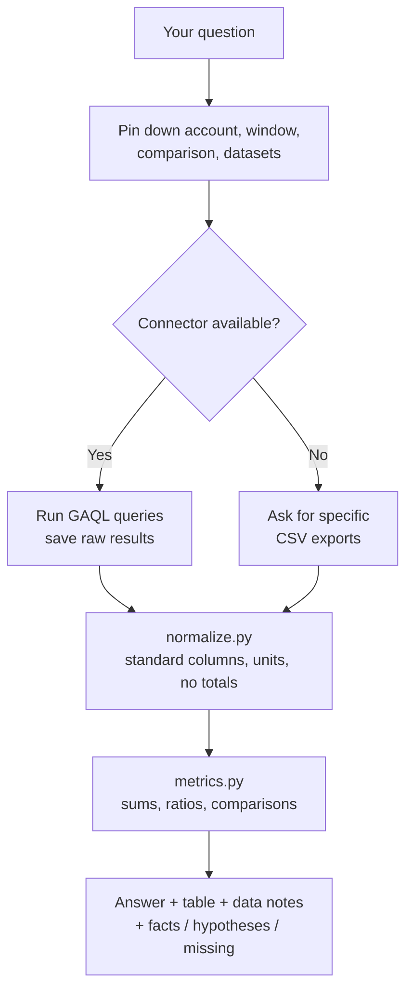

# Google Ads Data Pull | Get Accurate Google Ads Reports with Claude, from a Connector or CSV Exports

**Skill folder:** [`google-ads/google-ads-data-pull/`](../../google-ads/google-ads-data-pull/)

This skill gets Google Ads data into Claude and makes sure the numbers it reports are right. Ask something like *"compare last two weeks to the two before, by campaign"*. Claude pulls the data through a connected Google Ads tool, or tells you exactly which CSVs to download. It cleans the data into standard tables and runs every sum, ratio, and percentage change through a script, so you never get a made-up number or a drop reported as a rise. You get a short answer, a table, and the limits of the data stated up front.

General-purpose AI gets Google Ads numbers wrong in predictable ways: it averages ratios across rows, reads cost in micros as dollars, treats the search terms report as complete, and calls 5 clicks with no conversions "wasted spend". This skill closes each of those gaps with code and with rules about what the data can and can't show.

---

## What it's used for

- **Period comparisons you can trust.** This period against the last, by campaign or ad group, with every direction ("up", "down", "flat") computed by the script.
- **Search terms with context.** The search terms report, plus the share of clicks Google actually shows you, which on small accounts can be half or less.
- **Wasted spend, judged fairly.** For anything with zero conversions, the highest conversion rate the data rules out and your break-even rate, so "wasted" only means wasted when the data proves it.
- **Clean inputs for other skills.** Standard CSVs that [google-ads-apply-changes](google-ads-apply-changes.md) and [google-ads-change-log](google-ads-change-log.md) read directly.
- **Working without an API.** Exact export steps for the Google Ads web interface and Google Ads Editor, and a cleaner that reads those files as they are.

## At a glance

| | |
|---|---|
| **Area** | [Google Ads](../../google-ads/) |
| **Works in** | Claude (web and desktop apps), Claude Code, the Claude API, and other agents that support Agent Skills |
| **Use it by** | Asking in plain English, such as *"pull search terms for the last 30 days"* or *"why did CPA go up this month?"*, or naming the skill |
| **You provide** | A connected Google Ads tool, or CSV exports when there isn't one |
| **You get** | An answer, a table, data notes, and three short lists: facts, hypotheses, and missing data. Plus clean CSVs saved to `google-ads-data/<end-date>/`. |
| **Tools it uses** | A Google Ads connector that runs GAQL or reports (optional), and code execution for the scripts |
| **Version** | 1.0.0 |

---

## How it works



### Step 1: Pin down the request

Claude reads your [account context](google-ads-account-context.md) for the account ID, currency, time zone, conversion definitions, and target CPA or ROAS. It then settles the date window with explicit dates, a comparison window of the same length if needed, and the smallest set of datasets that answers the question.

### Step 2: Choose the source

| Available | What Claude does |
|---|---|
| A tool that runs GAQL, such as `search` on Google's official Google Ads MCP server | Runs queries from the bundled query pack. This is the preferred source. |
| A connector with fixed reports | Uses its reports, and marks any metric it doesn't return as MISSING |
| No connector | Asks for specific downloads, with steps |

This skill never calls a tool that changes your account.

### Step 3: Pull

Queries use explicit dates, so the pull can be repeated exactly. Claude checks unfamiliar field names with the connector's metadata tool, because Google renames fields every few months. A failed query is reported as MISSING with its error, never shown as zero. Raw results are saved to files rather than pasted into the chat.

### Step 4: Normalize

`normalize.py` reads connector JSON, GAQL-named CSVs, Google Ads web interface downloads, and Google Ads Editor exports, including Editor's UTF-16, tab-separated format. It does the following:

| Problem in the raw data | What the normalizer does |
|---|---|
| Different column names in each source ("Impr." vs. `metrics.impressions`) | Maps them to one standard set: `campaign`, `clicks`, `cost`, `conversions`, ... |
| Money in micros | Divides by 1,000,000 |
| Percentages as text ("45.12%") | Converts to fractions |
| Impression share shown as "< 10%" | Keeps 0.1 and adds a `_bound` column saying it's an upper limit |
| Report titles and Total rows in web downloads | Finds the real header and drops Total rows |
| Negatives mixed with keywords in Editor exports | Flags them in `is_negative`, with `negative_level` |
| `[exact]` and `"phrase"` punctuation | Strips it into `match_type` |
| Reported CTR, CPC, CPA, ROAS | Drops them, so they're recomputed from sums |

### Step 5: Compute

`metrics.py` produces every number Claude reports:

| Command | What it gives you |
|---|---|
| `summary` | Totals and ratios by any grouping. With a target CPA, adds break-even conversion rate and a verdict for zero-conversion rows. |
| `compare` | Current vs. prior for each metric: values, difference, percentage change, direction, and better or worse |
| `coverage` | Disclosed vs. total clicks per campaign for the search terms report |
| `zero-conv` | What zero conversions on N clicks rules out, and how many clicks it would take to know |

### Step 6: Report

Before writing conclusions, Claude reads the bundled guide to reading Google Ads data: what reports hide, why short windows mislead, and how small samples fool people. Every answer ends with facts (with dataset and window), hypotheses (with confidence), and missing data.

### What's in the skill folder

| File | What it holds | When Claude reads it |
|---|---|---|
| `SKILL.md` | The six steps and the rules | Every time the skill runs |
| `references/gaql-queries.md` | Queries for accounts, campaigns, settings, impression share, conversions, keywords, all four kinds of negatives, search terms, ads, landing pages, and change history | When pulling through a connector |
| `references/exports.md` | Download steps for the web interface and Google Ads Editor, and a sample request | When there's no connector |
| `references/reading-the-data.md` | What the data hides, positive vs. negative keyword inventories, small-sample rules, and how to state findings | Before any conclusion |
| `scripts/normalize.py` | The cleaner | On every raw file |
| `scripts/metrics.py` | The calculator | For every reported number |

---

## Setup

Plan on about 10 minutes, plus connector setup if you want one.

### 1. Install the skill

**Claude (web and desktop apps):** Download this repo (**Code → Download ZIP**), unzip it, and zip the `google-ads/google-ads-data-pull` folder on its own. In Claude, go to **Customize → Skills**, click **+**, choose **Create skill → Upload a skill**, and upload the zip. Code execution must be on in **Settings → Capabilities**, because the skill runs Python scripts.

**Claude Code:** Copy the `google-ads-data-pull` folder into `~/.claude/skills/` for all your projects, or into `.claude/skills/` in one project.

**Skills CLI (Claude Code, Codex, Cursor, and other agents):**

```bash
npx skills add Width-ai/claude-marketing-skills --skill google-ads-data-pull --global
```

See [Installing a skill](../../README.md#installing-a-skill) for the Claude API and more options.

### 2. Connect Google Ads (optional)

Any connector that can query your account works. A connector that accepts GAQL is best, because the bundled query pack covers every dataset the Google Ads skills use.

- **Google's official Google Ads MCP server** is free and runs any GAQL query. Google's [google-ads-api-mcp-setup skill](https://github.com/google/skills/tree/main/skills/ads/google-ads-api-mcp-setup) walks through setup. Since September 2026, Google Ads API access no longer needs a developer token. Access comes from the Google Cloud project that owns your OAuth credentials.
- **Third-party Google Ads connectors** work too. Claude uses whichever reports they offer and marks what they don't cover as MISSING.

Without a connector, the skill works from CSV downloads.

### 3. Add your business details

Install [google-ads-account-context](google-ads-account-context.md) and run it once. With a target CPA and conversion definitions on file, this skill can judge zero-conversion terms against break-even and read "conversions" correctly.

### 4. Add a line to your AGENTS.md (optional)

If your project has an AGENTS.md or CLAUDE.md, add this line so your agent follows the rule even before the skill loads:

```markdown
- Get Google Ads numbers with the google-ads-data-pull skill and compute every metric with its scripts, never by hand.
```

### 5. Test it

1. Start a new chat and send: *"Pull campaign performance for the last 14 days and compare it to the 14 days before."*
2. Claude confirms the account and the two windows, pulls the data (or asks for two Campaigns downloads), and answers with a table.
3. Check the data notes. They should name the source, the exact dates, the currency, and any campaigns in learning. Every "up" or "down" should match the table's direction column.

### 6. Make it yours

- **Standard weekly pull:** ask Claude to save the queries you use every week as a short list in your project, then say *"run my weekly pull"*.
- **Your own target:** pass a different target to `summary` for campaigns with their own goals, such as brand vs. non-brand.
- **More queries:** add queries to `references/gaql-queries.md` in the same format: what it answers, the query, and notes on row grain.

---

## Using it

| Ask for | What you get |
|---|---|
| *"How did each campaign do last month vs. the month before?"* | A comparison table with direction and better or worse per metric |
| *"Pull search terms for Search - Services, last 30 days"* | A clean search terms table and the share of clicks Google disclosed |
| *"Which keywords are wasting money?"* | A summary with break-even rates. Only rows where the data rules out break-even are called underperforming. |
| *"Are we losing impressions to budget or to rank?"* | Impression share by campaign, with "< 10%" values flagged |
| *"What changed in the account in the last two weeks?"* | Change history grouped by tool and user, with Google Ads Editor's gap noted |
| *"Here are my CSV exports, what's going on?"* | The same analysis from your files |

Tips for better results:

- Say what decision you're making. "Should I raise the budget on Brand?" gets a sharper pull than "show me Brand".
- Avoid ending windows on the last two or three days when conversions arrive late, or expect them flagged as incomplete.
- When a change happened mid-window, say so. Claude splits the window at the change date instead of averaging two different setups.

---

## Troubleshooting

| Symptom | Likely cause |
|---|---|
| Claude doesn't use the skill | The skill is turned off in **Customize → Skills**, or the request doesn't match its description. Name it directly: *"Use the google-ads-data-pull skill to ..."* |
| `UNRECOGNIZED_FIELD` errors | A field was renamed in a newer API version. Claude should check it with the connector's metadata tool and fix the query. Tell it to if it doesn't. |
| Queries fail on a manager account | Performance queries need a client account ID. Claude lists client accounts first; pick the right one. |
| Cost looks a million times too high | Raw micros weren't divided. Run the file through `normalize.py`. |
| Keyword counts look doubled | Negatives were counted as keywords, or daily rows weren't collapsed. Use the positive-keyword query, or `--group-by campaign,ad_group,keyword,match_type`. |
| The normalizer leaves a column unmapped | It's a column the alias list doesn't know. It passes through under a cleaned-up name, so the data isn't lost. |
| Scripts don't run in Claude | Code execution is off. Turn it on in **Settings → Capabilities**. |
| Web export has odd rows at the top | That's the report title and date range. The normalizer skips them automatically. |
