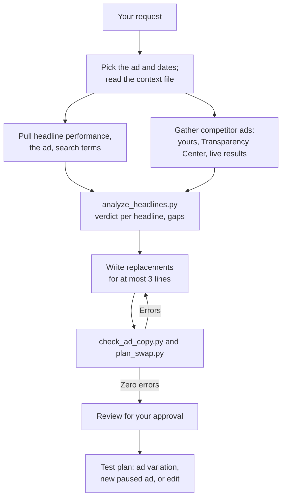

# Google Ads Headline Optimizer | Improve Responsive Search Ad Headlines with Claude, Using Real Performance Data and Competitor Ads

**Skill folder:** [`google-ads/google-ads-headline-optimizer/`](../../google-ads/google-ads-headline-optimizer/)

This skill improves the headlines of an ad that's already running. Say *"optimize the headlines on my Water Heater Repair ad"*. Claude pulls how each headline has performed, compares the headlines with each other and with your competitors' ads, picks the few that lag, writes replacements from the searches that convert and your approved claims, and gives you a plan to test the change. Nothing in your account changes until you approve it.

Most headline advice is a guess. Here a script does the math: each headline's CTR and conversions get a 95% range, and a line is called weaker only when its range sits clearly below the rest of the ad. Lines that work are kept exactly as they are, so they keep their history. Competitor ads come from your own research, Google's Ads Transparency Center, or the live search results, read in your browser without clicking anything.

---

## What it's used for

- **Replacing headlines that drag an ad down.** Lines Google rarely shows, and lines with clearly lower CTR or conversions than the rest of the ad, replaced three at a time at most.
- **Putting converting searches into the ad.** Searches that bring conversions but whose words appear in no headline, such as "leaking water heater" or "emergency water heater repair".
- **Standing out from competitors.** The claims competitors lead with that your ad doesn't make, your headlines that sound like theirs, and the words only you use.
- **Answering "which headlines are working?"** A table of every headline with impressions, serving share, CTR and its range, conversions, and a verdict.
- **Testing changes properly.** An ad variation with a 50% split, a new paused ad next to the old one, or an edit, with a review date.

## At a glance

| | |
|---|---|
| **Area** | [Google Ads](../../google-ads/) |
| **Works in** | Claude (web and desktop apps), Claude Code, the Claude API, and other agents that support Agent Skills |
| **Use it by** | Asking in plain English, such as *"which headlines on the tankless ad should I replace?"*, or naming the skill |
| **You provide** | The ad, its headline performance (through a connector or an export), your account context file with approved claims, and (optional) competitor ads or permission to collect them |
| **You get** | A headline review, the new headline set checked against Google's limits and your claims, a test plan, and a change set for google-ads-apply-changes |
| **Tools it uses** | Code execution, a Google Ads connector (optional), and Claude in Chrome for competitor ads (optional) |
| **Version** | 1.0.0 |

---

## How it works



### Step 1: Pick the ad and the dates

Claude confirms which ad to work on and picks the dates: from the last time the headlines changed to yesterday, 30 to 90 days. Google has full headline-level stats only from June 5, 2025. If the headlines changed in the last two weeks, Claude says it's too soon.

### Step 2: Read your context and pull the data

Claude reads your [account context](google-ads-account-context.md) for approved offers and proof, brand voice, and your competitor policy. With a Google Ads connector, it pulls each headline's impressions, clicks, and conversions, the ad's full headline list and totals, and the ad group's search terms and keywords. Without one, it tells you which exports to download.

### Step 3: Gather competitor ads

Claude starts with any competitor research you already have. With your go-ahead, it collects more with Claude in Chrome: the text ads your competitors run, from Google's Ads Transparency Center, and the ads showing right now for your top converting searches. A bundled script reads the ads on the results page without clicking any of them. Every line is saved with its date and source.

### Step 4: Analyze

`analyze_headlines.py` compares each headline with the ad's other headlines:

| Verdict | When |
|---|---|
| **replace** | Google hasn't shown it, or shows it under a tenth as often as the top headline with no conversions, or its CTR or conversions per impression are clearly below the others |
| **keep** | Clearly above the others on CTR or conversions per impression |
| **keep for now** | No clear difference |
| **too early** | The ad has under 2,000 impressions, or Google lists the line as learning |
| **pinned** | Pinned to a position, so it isn't compared |

It also lists converting searches no headline echoes, themes the remaining lines don't cover (keyword, proof, offer, call to action), near duplicates, and, with competitor ads, the claim types competitors use that you don't, your lines that sound like theirs, and words only you use.

### Step 5: Write and check the replacements

Claude replaces at most three lines a round, keeping any line that's the only one carrying something the ad needs. New lines come from converting searches, missing themes, competitor gaps, and your differences. Any claim needs your approval first; a competitor making a claim doesn't approve it for you. `check_ad_copy.py` checks Google's limits, your approved claims, and Google's editorial rules. `plan_swap.py` checks that every kept line matches the live ad exactly, because Google treats even a change in capitals as a new line with no history.

### Step 6: Test it

You pick how the change goes in:

| Route | What happens |
|---|---|
| **Ad variation** (recommended) | Google runs the original and the new headlines side by side on the same ad, each for half your audience. You set it up under Experiments in Google Ads, from Claude's steps. |
| **New ad** | A new paused ad with the new headlines goes in through [google-ads-apply-changes](google-ads-apply-changes.md) or Google Ads Editor, next to the old one. |
| **Edit** | You edit the live ad. Google keeps the old version's stats separately, and the ad starts learning again. |

Each route comes with a review date, about four weeks out. A change set entry lets google-ads-apply-changes preview and log it.

### What's in the skill folder

| File | What it holds | When Claude reads it |
|---|---|---|
| `SKILL.md` | The rules, the nine steps, and the output format | Every time the skill runs |
| `references/performance-data.md` | Picking dates, the connector queries, and export steps | When pulling the ad's data |
| `references/competitor-research.md` | Where competitor ads come from, how to collect them in the browser, the competitor file format, and how to read the comparison | When gathering competitor ads |
| `references/decision-rules.md` | How the verdicts work, choosing lines, where new lines come from, writing rules, the three routes, and reviewing results | Before writing any headline |
| `references/copy-file.md` | The copy file and approved-claims file formats, with source tags | When writing the new headline set |
| `scripts/analyze_headlines.py` | The headline review | After pulling the data |
| `scripts/extract_sponsored_ads.js` | Reads text ads on a Google results page, without clicking | When collecting live competitor ads |
| `scripts/check_ad_copy.py` | Checks limits, claims, and Google's editorial rules | On every draft |
| `scripts/plan_swap.py` | Compares the new set with the live ad and writes the test plan | On every draft, and for the hand-off |
| `scripts/build_upload_files.py` | Builds a new paused ad as a change set and Editor files | For the new-ad route |

---

## Setup

Plan on about 10 minutes, plus the account context if you don't have one yet.

### 1. Install the skill

**Claude (web and desktop apps):** Download this repo (**Code → Download ZIP**), unzip it, and zip the `google-ads/google-ads-headline-optimizer` folder on its own. In Claude, go to **Customize → Skills**, click **+**, choose **Create skill → Upload a skill**, and upload the zip. Code execution must be on in **Settings → Capabilities**, because the skill runs Python scripts.

**Claude Code:** Copy the `google-ads-headline-optimizer` folder into `~/.claude/skills/` for all your projects, or into `.claude/skills/` in one project.

**Skills CLI (Claude Code, Codex, Cursor, and other agents):**

```bash
npx skills add Width-ai/claude-marketing-skills --skill google-ads-headline-optimizer --global
```

See [Installing a skill](../../README.md#installing-a-skill) for the Claude API and more options. This skill works best with [google-ads-account-context](google-ads-account-context.md) for your approved claims and [google-ads-apply-changes](google-ads-apply-changes.md) for getting changes into the account.

### 2. Connect tools (optional)

- **A Google Ads connector that reads** lets Claude pull headline performance, the ad, and search terms. Google's official Google Ads MCP server works, and so do third-party connectors that run GAQL. Without one, Claude asks for a few exports.
- **Claude in Chrome** lets Claude collect competitor ads from the Ads Transparency Center and live search results. Without it, share your own competitor research, or skip that part.

### 3. Add your business details

Run [google-ads-account-context](google-ads-account-context.md) once. Fill in "Business and offer" with every offer, price, and proof point you're happy to show in ads, and list your main competitors under "Competitor policy". The skill uses only those claims, and keeps competitor names out of your headlines unless your policy allows them.

### 4. Add a line to your AGENTS.md (optional)

If your project has an AGENTS.md or CLAUDE.md, add this line so your agent follows the rule even before the skill loads:

```markdown
- Optimize Google Ads headlines with the google-ads-headline-optimizer skill: keep working lines exactly as they are, replace at most 3 per round, and use only claims approved in `.agents/google-ads-context.md`.
```

### 5. Test it

1. Start a new chat and send: *"Review the headlines on my Water Heater Repair ad for the last 60 days, and compare them with competitor ads for 'water heater repair austin'."*
2. Claude pulls the data (or asks for exports), asks before opening the browser, runs the analysis, and shows the headline table. Allow a few minutes.
3. Check the table: every headline has impressions, a CTR with a range, and a verdict with a reason. Nothing has changed in your account.

### 6. Make it yours

- **Your claims:** keep the context file's "Business and offer" section current. New headlines can only use what's there or what you approve in the chat.
- **Your competitors:** list them in the context file, or keep a competitor file with their current ads and attach it.
- **Your thresholds:** the analyzer's defaults (2,000 ad impressions before judging, 200 per headline before comparing rates, a tenth of the top headline's impressions for "rarely shown", 3 replacements per round) sit at the top of `scripts/analyze_headlines.py`.

---

## Using it

| Ask for | What you get |
|---|---|
| *"Optimize the headlines on the Tankless ad"* | The headline review, up to three replacements with alternates, and a test plan |
| *"Which of my headlines are working?"* | The headline table with verdicts, and nothing else changed |
| *"Here's our competitor analysis, use it to improve our headlines"* | The comparison from your file: claims they make that you don't, lines that sound like theirs, and new lines that stand apart |
| *"Check the ads showing for 'emergency plumber austin' and compare them to my ad"* | Live competitor ads read in Chrome, with the comparison |
| *"Set it up as a new ad instead"* | A new paused ad as a change set and Editor files |
| *"The variation finished, what's next?"* | A fresh review of the winning ad, dated from when it went live |

Tips for better results:

- Give it at least 30 days of data. With fewer impressions, most headlines show as "keep for now" or "too early".
- Approve or reject claims Claude asks about. Competitor gaps can only be filled with claims your business can stand behind.
- Run one round at a time. Let a test finish before changing the same ad again.
- Use the ad variation route when you can. It's the only one where both versions run at the same time to the same kind of audience.

---

## Troubleshooting

| Symptom | Likely cause |
|---|---|
| Claude doesn't use the skill | The skill is turned off in **Customize → Skills**, or the request doesn't match its description. Name it directly: *"Use the google-ads-headline-optimizer skill to ..."* |
| Every headline shows as "too early" | The ad has under 2,000 impressions in the dates used. Use a longer range (up to 90 days), or add lines to empty slots and wait. |
| The analyzer says there's more than one ad | The export or query covered several ads. Tell Claude which ad, or give its ID. |
| A headline you know is in the ad is missing from the table | It never showed in those dates, and the ad itself wasn't pulled. Give Claude the ad (or an Ads page export) as well as the asset details. |
| `plan_swap.py` says a kept line differs | The kept line was retyped with a small change. Copy it exactly from the live ad. |
| A kept line fails the claims check | It's live but makes a claim that isn't in your approved list. Approve the claim, or replace the line. |
| The browser script finds no text ads | That search showed only Local Services ads or shopping ads, or no ads at all. Try another search term. |
| The browser shows a CAPTCHA | Google flagged the searches. Solve it in the Chrome tab and ask Claude to continue. |
| Scripts don't run in Claude | Code execution is off. Turn it on in **Settings → Capabilities**. |
