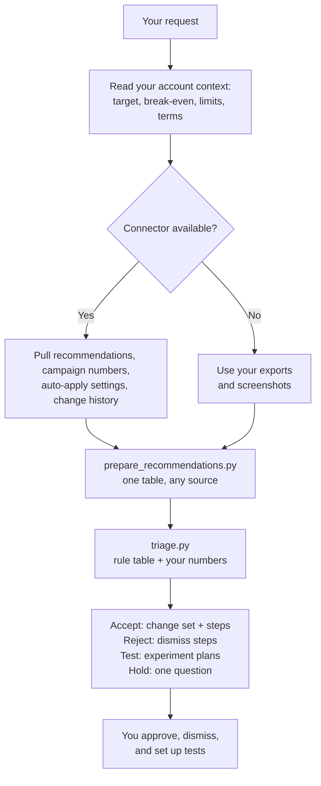

# Google Ads Recommendations Triage | Decide Which Google Ads Recommendations to Accept, Reject, or Test with Claude

**Skill folder:** [`google-ads/google-ads-recommendations-triage/`](../../google-ads/google-ads-recommendations-triage/)

This skill goes through your open Google Ads recommendations and sorts each one into accept, reject, or test, with a reason in plain words that names your own numbers. Ask *"should I accept my Google Ads recommendations?"*. Claude pulls the recommendations and your campaign numbers through a connected Google Ads tool, or works from your exports and screenshots. It checks every recommendation against your target and break-even CPA or ROAS, and you get a triage table, a change set for what to accept, dismiss steps for what to reject, and an experiment plan for what to test.

Google's recommendations aren't written with your margins in mind, and many of them mainly raise spend: bigger budgets, looser targets, broad match, AI Max, new networks. This skill flags those and prices them with Google's own estimate, for example "Google's estimate puts each extra conversion at $142, 18% above break-even." It also checks whether auto-apply is changing your account without asking, and explains what optimization score really measures. It never applies or dismisses anything itself.

---

## What it's used for

- **Clearing the Recommendations page with confidence.** Every card gets a verdict and a one-line reason, such as *"Budget-limited, but CPA is 40% above break-even, so more budget buys more loss."*
- **Saying no to spend increases that don't pay.** Budget raises are judged on whether the campaign is really budget-limited, whether its CPA or ROAS meets your target, and what Google's estimate says the extra conversions would cost.
- **Testing instead of guessing.** Bid strategy switches, broad match, AI Max, search partners, and Performance Max get an experiment plan with a split, a duration, a success metric, and a guardrail, plus an honest note on how much the test can show at your volume.
- **Stopping auto-apply surprises.** See which recommendation types Google applies on its own, what it changed in the last 30 days, and which types to turn off.
- **Putting optimization score in its place.** A plain note that the score measures how much of Google's advice you've adopted, not how well the account performs.

## At a glance

| | |
|---|---|
| **Area** | [Google Ads](../../google-ads/) |
| **Works in** | Claude (web and desktop apps), Claude Code, the Claude API, and other agents that support Agent Skills |
| **Use it by** | Asking in plain English, such as *"review my Google Ads recommendations"* or *"should I raise the budget Google suggests?"*, or naming the skill |
| **You provide** | A connected Google Ads tool, or a Recommendations page export (screenshots work) and a campaign report for the last 30 days. Your target and break-even CPA or ROAS. |
| **You get** | A triage report with a verdict and reason for every recommendation, a change set for accepted changes, dismiss steps, experiment plans, an auto-apply check, and an optimization score note |
| **Tools it uses** | Code execution, and a Google Ads connector that runs GAQL (optional) |
| **Version** | 1.0.0 |

---

## How it works



### Step 1: Read your account context

Claude reads the [account context](google-ads-account-context.md) file for the facts the account data can't show: your target and break-even CPA or ROAS, which conversions are real, how big a budget or target change may be in one batch, protected terms, terms you don't want, and approved offers. Anything marked MISSING stays missing. Recommendations that need it are held, never guessed.

### Step 2: Get the recommendations and your numbers

| Available | What Claude does |
|---|---|
| A connector that runs GAQL, such as Google's official Google Ads MCP server | Pulls open recommendations with Google's estimates, campaign numbers and settings, impression share lost to budget, optimization score, auto-apply settings, and the changes recommendations made in the last 30 days |
| No connector | Asks for the Recommendations page export (or card screenshots), a 30-day campaign report, and your auto-apply list |
| Suggestions from Ads Advisor or Ask Advisor | Puts them in the same table and judges them the same way |

Some recommendation types, such as AI Max and "Remove redundant keywords", only exist in the Google Ads interface, so an export helps even when a connector works.

### Step 3: Judge each recommendation

`triage.py` joins every recommendation to its campaign's numbers and applies a rule table that covers every type in the current Google Ads API, plus the common interface-only types:

| Recommendation | Usual verdict | What changes it |
|---|---|---|
| Raise your budgets | Reject | Accept only when the campaign is budget-limited, meets your target, and Google's own estimate keeps the extra conversions within break-even. Accepted raises are capped at your per-batch limit. |
| Adjust your CPA or ROAS targets | Depends | Reject past break-even, test past your target, accept within your target |
| Bid more efficiently with Target CPA, Maximize conversions, and similar | Test | Reject with no conversions, no conversion values, or a suggested target past break-even |
| Add broad match keywords, Turn on AI Max | Test at most | Reject without Smart Bidding, when past target, or when budget-limited |
| Add new keywords | Depends | Reject duplicates, terms you don't want, keywords a negative blocks, and campaigns losing money. Accept the rest, paused, for you to check. |
| Remove redundant or non-serving keywords | Depends | Keep anything that converted or served. Pause (never delete) keywords with no impressions. |
| Search partners, Display expansion, optimized targeting | Reject | Test only when the campaign meets target and isn't budget-limited |
| Performance Max | Test at most | Reject when the account loses money or has no conversions |
| Assets, ad improvements, ad rotation | Accept | Written from your approved offers and proof, never Google's suggested text |
| Conversion tracking and enhanced conversions | Accept | You make these changes yourself; an agent never touches tracking |
| Enhanced CPC and other retired features | Reject | Always |

Every reason names the numbers that decided it. Two changes to the same campaign are put in order, so you never run two at once and can't tell which worked.

### Step 4: Turn verdicts into actions

- **Accept:** a change set for [google-ads-apply-changes](google-ads-apply-changes.md), which checks it against your live account, shows a preview, and applies only what you approve. Numbered steps for the Google Ads interface cover everything else, and work without that skill.
- **Reject:** steps to dismiss the cards yourself.
- **Test:** an experiment plan for each: the experiment type (custom, AI Max, Performance Max, or a network test), a 50% split, the duration in days, the success metric against your target, a break-even guardrail, and the expected conversions per arm.
- **Hold:** the one question or missing number that decides it.

### Step 5: Check auto-apply and optimization score

The report shows which auto-apply types are on, what auto-apply changed recently, and which types to turn off. It also lists the auto-apply types the API can't see, so you can check them on the Auto-apply settings page. Then it gives your optimization score with a plain note: the score rises when you apply or dismiss Google's suggestions, and says nothing about whether the account makes money.

### What's in the skill folder

| File | What it holds | When Claude reads it |
|---|---|---|
| `SKILL.md` | The verdicts, rules, steps, and report format | Every time the skill runs |
| `references/data-access.md` | Queries for recommendations, campaigns, auto-apply, and change history, what the current API offers, and export steps when there's no connector | When pulling data or asking for exports |
| `references/recommendation-types.md` | The rule table: every recommendation type, its default verdict, and the conditions that change it | When explaining a verdict or judging a hold |
| `references/actions.md` | How to accept, dismiss, set up and read experiments, plus the auto-apply and optimization score notes | When writing the report |
| `scripts/prepare_recommendations.py` | Turns recommendations from a connector, an export, or typed screenshots into one table | Before the triage |
| `scripts/triage.py` | Applies the rules and writes the report, the table, and the change set | For every triage |
| `scripts/normalize.py` | Cleans campaign, keyword, and history data (shared with google-ads-data-pull) | On every raw file |
| `scripts/metrics.py` | Statistics used by the triage, and experiment readouts (shared with google-ads-data-pull) | During the triage and when reading tests |

---

## Setup

Plan on about 10 minutes, plus connector setup if you want one.

### 1. Install the skill

**Claude (web and desktop apps):** Download this repo (**Code → Download ZIP**), unzip it, and zip the `google-ads/google-ads-recommendations-triage` folder on its own. In Claude, go to **Customize → Skills**, click **+**, choose **Create skill → Upload a skill**, and upload the zip. Code execution must be on in **Settings → Capabilities**, because the skill runs Python scripts.

**Claude Code:** Copy the `google-ads-recommendations-triage` folder into `~/.claude/skills/` for all your projects, or into `.claude/skills/` in one project.

**Skills CLI (Claude Code, Codex, Cursor, and other agents):**

```bash
npx skills add Width-ai/claude-marketing-skills --skill google-ads-recommendations-triage --global
```

See [Installing a skill](../../README.md#installing-a-skill) for the Claude API and more options. It works well alongside [google-ads-apply-changes](google-ads-apply-changes.md) for applying what you accept and [google-ads-change-log](google-ads-change-log.md) for the record.

### 2. Connect Google Ads (optional)

A connector that runs GAQL lets Claude pull recommendations, Google's estimates, auto-apply settings, and change history directly.

- **Google's official Google Ads MCP server** is free and reads everything this skill needs. It can't apply or dismiss recommendations, which suits this skill: it only reads.
- **Third-party Google Ads connectors** work if they can query recommendations. If yours can also apply or dismiss them, the skill still won't use that.

Without a connector, export the Recommendations page (table view, as CSV) and a 30-day Campaigns report. Screenshots of recommendation cards work too.

### 3. Add your business details

Run [google-ads-account-context](google-ads-account-context.md) once. The triage leans on its Economics section most: without a target and break-even, every recommendation that raises spend is held. It also uses your conversion notes, change limits, protected terms, and terms you don't want.

### 4. Add a line to your AGENTS.md (optional)

If your project has an AGENTS.md or CLAUDE.md, add this line so your agent follows the rule even before the skill loads:

```markdown
- Never apply or dismiss Google Ads recommendations directly. Triage them with the google-ads-recommendations-triage skill first.
```

### 5. Test it

1. Start a new chat and send: *"Review my open Google Ads recommendations for the last 30 days. Target CPA is $80, break-even is $120."*
2. Claude pulls the recommendations and campaign numbers (or asks for the two exports), runs the triage, and replies with the report. Expect a few minutes for a large account.
3. Check one budget recommendation in the table. Its reason should name the campaign's CPA, your target or break-even, and how much impression share it lost to budget. Nothing in your account should have changed.

### 6. Make it yours

- **Your own thresholds:** "budget-limited" defaults to 10% or more of impression share lost to budget, or 90% of budget spent; tests aim for 30 conversions per arm. Ask Claude to pass different values (`--budget-lost-threshold`, `--budget-use-threshold`, `--min-test-conversions`).
- **Your own limits:** set the max budget and target change per batch in the account context's Permissions and limits section. Accepted steps never go past them.
- **A rule for your business:** edit `references/recommendation-types.md` and the matching rule in `scripts/triage.py` together.
- **One-off decisions:** tell Claude your call on any recommendation ("accept the lead form asset, we can handle those leads"). It records it as an override with your name, and the report shows what changed.

---

## Using it

| Ask for | What you get |
|---|---|
| *"Should I accept my Google Ads recommendations?"* | The full report: table, change set, dismiss steps, experiment plans, auto-apply check, optimization score note |
| *"Google wants me to raise the Furnace budget to $130. Should I?"* | One verdict with the campaign's CPA, budget-lost share, and the cost of the extra conversions from Google's estimate |
| *"Is auto-apply on? What has it changed?"* | The auto-apply types that are on, the changes auto-apply made in the last 30 days, and which types to turn off |
| *"My optimization score is 64%. What should I do?"* | What the score measures, why it isn't a performance number, and which open recommendations are worth acting on |
| *"Here's a screenshot of my Recommendations page and my campaign report"* | The same triage from your files, with anything the screenshot doesn't show marked MISSING |
| *"Ask Advisor suggested switching to broad match. Is that a good idea?"* | A verdict on the suggestion with the same rules as any recommendation |

Tips for better results:

- Give your break-even, not just your target. The target says what you'd like; break-even says where ads start losing money, and it decides most rejects.
- Mention known tracking problems (spam leads, double-counted forms). Bidding and broad match changes are held until they're fixed.
- Run it monthly, or whenever the Recommendations page fills up. Dismissed recommendations can come back.
- Read the "expected volume" line on each test. On small accounts, a test shows a direction, not proof, and the plan says so.

---

## Troubleshooting

| Symptom | Likely cause |
|---|---|
| Claude doesn't use the skill | The skill is turned off in **Customize → Skills**, or the request doesn't match its description. Name it directly: *"Use the google-ads-recommendations-triage skill to ..."* |
| Almost everything is on hold | The Economics section is missing a target and break-even, or the campaign data wasn't pulled. Give them, and Claude re-runs. |
| A recommendation you can see isn't in the table | Some types (AI Max, removing keywords, conflicting negatives) aren't in the Google Ads API. Export the Recommendations page and attach it. |
| "Not in the rule table" holds | Google added a new recommendation type. Claude judges it by hand with the general rules and records the verdict as an override. |
| `UNRECOGNIZED_FIELD` error | A field was renamed in a newer API version. Claude should check it with the connector's metadata tool and fix the query. |
| A budget raise was accepted for less than Google suggested | Your per-batch limit caps each step. Approve the next step after the review date, or approve the larger move for that line in google-ads-apply-changes. |
| The card is still on the Recommendations page after you made the change | Google recalculates on its own schedule. Don't press Apply as well, or the change could be made twice. |
| Auto-apply shows as unknown | Neither the auto-apply settings nor change history were available. Check **Recommendations → Auto-apply settings** in Google Ads. |
| Scripts don't run in Claude | Code execution is off. Turn it on in **Settings → Capabilities**. |
