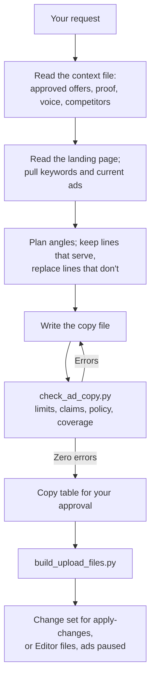

# Google Ads RSA Asset Writer | Write Responsive Search Ads, Sitelinks, and Callouts with Claude, Checked Against Google's Limits

**Skill folder:** [`google-ads/google-ads-rsa-asset-writer/`](../../google-ads/google-ads-rsa-asset-writer/)

This skill writes Google Ads copy: responsive search ad headlines and descriptions, plus sitelinks, callouts, and structured snippets. Say *"write a new RSA for the Water Heater Repair ad group"*. Claude reads your approved offers and proof from your account context file, reads the landing page, looks at the ad group's keywords and how your current headlines perform, and writes the copy. A bundled script checks every line. You get a copy table with character counts, plus files that put the new ads into your account paused once you approve them.

General-purpose AI makes ad copy up. Tests have caught chatbots inventing "20% off!" offers and "1,000+ teams" proof points, and overrunning character limits. Here, a script fails any number, price, "free", guarantee, superlative, rating, award, or customer count that isn't in your approved list. It also checks Google's limits (counting Chinese, Japanese, and Korean characters double), duplicates, Google's editorial rules, pinning, and whether the ad covers your keywords, an offer, proof, and a call to action.

---

## What it's used for

- **A second RSA for an ad group.** Google recommends at least two good ads per ad group. Claude writes one with a different angle from the ad you already run, keeps your best-serving lines, and replaces the ones Google rarely shows.
- **Ads for a new ad group.** Headlines built from the keywords, the landing page's promise, and your approved offers and proof, with every line counted against Google's limits.
- **Sitelinks, callouts, and snippets.** Written to Google's rules for each: unique sitelink text, no callout that repeats your ad text, snippet values that aren't promotional.
- **Checking copy someone else wrote.** Paste ads from a colleague or agency and get every limit, policy risk, and unsupported claim flagged.
- **Keeping offers honest.** Ads that rely on an offer that has ended, or say "this week only" when the offer runs to December, are caught before they go live.

## At a glance

| | |
|---|---|
| **Area** | [Google Ads](../../google-ads/) |
| **Works in** | Claude (web and desktop apps), Claude Code, the Claude API, and other agents that support Agent Skills |
| **Use it by** | Asking in plain English, such as *"write RSAs for the tankless ad group"* or *"check these headlines"*, or naming the skill |
| **You provide** | The campaign and ad group, your account context file with approved offers and proof, and (optional) a connector or exports for keywords and current ads |
| **You get** | A copy table with character counts and check results, a change set for google-ads-apply-changes, and Google Ads Editor import files, with new ads paused |
| **Tools it uses** | Code execution, web fetch for the landing page, and a Google Ads connector (optional) |
| **Version** | 1.0.0 |

---

## How it works



### Step 1: Read the context

Claude reads your [account context](google-ads-account-context.md): the offers, prices, and proof points approved for ads (with end dates), your required disclaimers, words to use and avoid, your competitor policy, and your protected brand and product names. Items still marked "confirm" don't count as approved yet. Without a context file, Claude offers to create one, or asks you for your approved offers and proof in one message.

### Step 2: Gather the evidence

Claude reads the landing page and notes what it promises. Any offer or proof it finds there that isn't in your approved list is shown to you as "seen on the page, needs approval". With a Google Ads connector, Claude pulls the ad group's current ads and pins, how each headline and description performs, the keywords that convert, and the sitelinks and callouts already running. Without one, it tells you which exports to download.

### Step 3: Plan and write

Claude picks a few distinct angles, such as speed, proof, price, or a specific audience. Using the script's numbers, it keeps the lines Google serves most and replaces lines that get under a tenth of the top line's impressions with no conversions. It writes in the style of your best-serving ads, aiming for 10 to 15 headlines and 4 descriptions, with no pins unless a line must always show. Every line is tagged with where it came from: a keyword, an approved claim, or new wording with no claim in it.

### Step 4: Check every line

`check_ad_copy.py` runs on every draft, and Claude rewrites until it reports zero errors:

| Check | Result |
|---|---|
| Headlines over 30 characters, descriptions over 90, paths over 15, sitelink text over 25, sitelink lines over 35, callouts and snippet values over 25 | Error. Wide characters count double, as Google counts them. Keyword insertion counts by its default text. |
| A number, price, "free", guarantee, superlative, rating, award, credential, or deadline that isn't an approved claim | Error, with the closest approved item suggested |
| A claim resting on an item still marked "confirm", or on an offer past its end date | Error |
| "This week only" or "ends Friday" without an approved offer that really ends then | Error |
| Repeated punctuation, emoji, gimmicky capitals like "FREE", phone numbers, extra spaces | Error |
| Exclamation marks or leading punctuation in sitelinks, callouts, or snippets; repeated sitelink text; a callout that repeats ad text; promotional snippet values | Error, from Google's rules for those assets |
| Words your context says to avoid, competitor names your policy doesn't allow | Error |
| Duplicate lines | Error; near duplicates are warnings |
| Heavy pinning, or one line pinned alone to a position | Warning |
| Missing keyword, offer, proof, or call-to-action coverage | Warning |
| Superlatives such as "best", offers not shown on the landing page, offers ending within two weeks, lines already running | Warning |

### Step 5: Approve and hand off

You see the copy table, the warnings, every claim with the approved item behind it, and anything that needs your answer. After you approve, `build_upload_files.py` writes the files. With [google-ads-apply-changes](google-ads-apply-changes.md) installed, the new ads go in a change set it previews, applies paused, and logs. Without it, you get Google Ads Editor files and step-by-step import instructions. Sitelinks, callouts, and snippets always come as Editor files, because apply-changes has no action for them. Google's official Google Ads MCP server can create them instead, but you'd link them to the campaign by hand.

### What's in the skill folder

| File | What it holds | When Claude reads it |
|---|---|---|
| `SKILL.md` | The rules, the seven steps, and the output format | Every time the skill runs |
| `references/writing-rules.md` | Google's limits (checked November 2026), what counts as a claim and where approved claims come from, the RSA headline mix, angles, learning from existing ads, pinning, sitelink, callout, and snippet rules, Google's editorial rules, and phrases that read as AI-written | Before writing any copy |
| `references/copy-file-format.md` | The copy file and approved-claims file formats, with source tags | When writing the copy file |
| `references/evidence-queries.md` | Queries for current ads, line performance, keywords, search terms, and existing assets, plus export steps | When pulling account data |
| `references/delivery-routes.md` | The change set, Editor files, the official MCP route for assets, manual steps, and logging | When handing the copy off |
| `scripts/check_ad_copy.py` | The checker | On every draft |
| `scripts/build_upload_files.py` | Builds the change set, Editor files, and import manifest | After you approve |

---

## Setup

Plan on about 10 minutes, plus the account context if you don't have one yet.

### 1. Install the skill

**Claude (web and desktop apps):** Download this repo (**Code → Download ZIP**), unzip it, and zip the `google-ads/google-ads-rsa-asset-writer` folder on its own. In Claude, go to **Customize → Skills**, click **+**, choose **Create skill → Upload a skill**, and upload the zip. Code execution must be on in **Settings → Capabilities**, because the skill runs Python scripts.

**Claude Code:** Copy the `google-ads-rsa-asset-writer` folder into `~/.claude/skills/` for all your projects, or into `.claude/skills/` in one project.

**Skills CLI (Claude Code, Codex, Cursor, and other agents):**

```bash
npx skills add Width-ai/claude-marketing-skills --skill google-ads-rsa-asset-writer --global
```

See [Installing a skill](../../README.md#installing-a-skill) for the Claude API and more options. This skill works best with [google-ads-account-context](google-ads-account-context.md) for your approved claims and [google-ads-apply-changes](google-ads-apply-changes.md) for getting the ads into the account.

### 2. Connect tools (optional)

- **A Google Ads connector that reads** lets Claude pull your keywords, current ads, and how each line performs. Google's official Google Ads MCP server works, and so do third-party connectors that run GAQL. Without one, Claude asks for a few exports.
- **Web fetch** lets Claude read your landing page. Without it, paste the page's key points.
- **Google Ads Editor** (free from Google) is needed only if you'll import the Editor files.

### 3. Add your business details

Run [google-ads-account-context](google-ads-account-context.md) once, and fill in the "Business and offer" section carefully: every offer with its end date, every price you're happy to show, and every proof point with where it comes from. That list is the only source of claims this skill will use. Without a context file, you can tell Claude your approved offers and proof at the start of the chat, and it saves them in an approved-claims file.

### 4. Add a line to your AGENTS.md (optional)

If your project has an AGENTS.md or CLAUDE.md, add this line so your agent follows the rule even before the skill loads:

```markdown
- Write Google Ads copy with the google-ads-rsa-asset-writer skill, and use only claims approved in `.agents/google-ads-context.md`.
```

### 5. Test it

1. Start a new chat and send: *"Write one RSA for my Water Heater Repair ad group. The landing page is example.com/water-heaters. Use only offers from my context file."*
2. Claude reads your context and the page, may ask about page facts that aren't approved yet, writes the copy, runs the checker, and shows the copy table. Allow a few minutes.
3. Check the table: every headline shows a count like 26/30, the Claims column shows "approved" next to each claim, and the checker reports zero errors. Nothing has been changed in your account.

### 6. Make it yours

- **Your claims:** keep the context file's "Business and offer" section current. Add end dates to offers, so the checker can stop ads from promoting expired ones.
- **Your voice:** list words to use and avoid under "Brand voice and copy rules". The checker fails any line with an avoided word.
- **Your thresholds:** the checker's defaults (10 or more headlines, 4 or more callouts, two weeks' notice before an offer ends) sit at the top of `scripts/check_ad_copy.py`. Google's limits sit there too; change those only if Google does.

---

## Using it

| Ask for | What you get |
|---|---|
| *"Write a second RSA for the Tankless ad group"* | A new ad with a different angle from the current one, the best-serving lines kept, a copy table, and files to apply it paused |
| *"Write RSAs for every ad group in Search - Drains"* | One copy file covering each ad group, checked together, with one change set |
| *"Add sitelinks and callouts to the water heater campaign"* | Sitelinks with both description lines, callouts that don't repeat your ads, and Editor files to import them |
| *"Check these headlines before I upload them"* | Every limit, policy risk, and unapproved claim flagged, with fixes |
| *"Which of my current headlines are working?"* | Impressions, CTR, conversions, and serving share for each line, computed by the script |
| *"We approved free second opinions, use that"* | The claim saved to an approved-claims file and used in the copy |

Tips for better results:

- Approve or reject the page facts Claude asks about. Each "yes" becomes an approved claim; suggest adding it to your context file so it's there next time.
- Give Claude your keyword report, or let it pull one. Headlines built from the words people actually search for usually beat clever ones, and the coverage check needs them.
- Ask for a different angle by name: *"lead with speed this time"* or *"write one for landlords"*.
- Keep the old ad running next to the new one, and compare them after a few weeks of traffic. Google allows 3 enabled RSAs per ad group.

---

## Troubleshooting

| Symptom | Likely cause |
|---|---|
| Claude doesn't use the skill | The skill is turned off in **Customize → Skills**, or the request doesn't match its description. Name it directly: *"Use the google-ads-rsa-asset-writer skill to ..."* |
| Every claim shows as "not approved" | The context file wasn't found or its "Business and offer" section says MISSING. Check the file is at `.agents/google-ads-context.md`, or tell Claude your approved offers and proof. |
| A claim you approved still fails | The wording doesn't match the approved item. "Free estimates" doesn't approve "free quotes". Use the approved wording, or approve the new wording too. |
| A proof point you know is true fails as "still marked confirm" | The context file has "confirm" next to it, from when it was read off your website. Confirm it, and update the context file. |
| An offer fails as "ended" | Its end date in the context file has passed. Update the date if the offer was extended, or remove it from the ad. |
| apply-changes rejects a headline with `{KeyWord:...}` as too long | Its validator counts the token's braces. Google counts the default text, which the checker passed. Use this skill's Editor files for that ad. |
| The Editor import preview doesn't recognize a column | Your Editor uses a different header spelling. Export a small sample from Editor and have Claude rebuild with `--template sample.csv`. |
| Snippet values import as one value | Editor didn't split the Snippet Values cell on semicolons. Add the snippet by hand in Google Ads under Assets. |
| Sitelinks started showing as soon as they were posted | Editor files have no paused state for assets. Import them only when you want them live, or create them through the official MCP server and link them later. |
| Scripts don't run in Claude | Code execution is off. Turn it on in **Settings → Capabilities**. |
