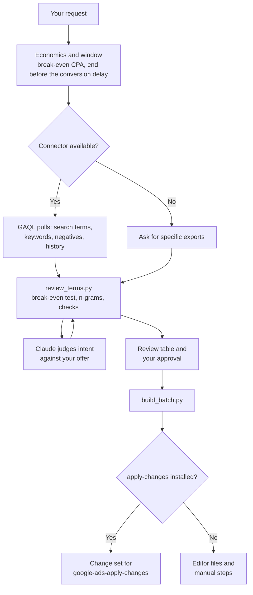

# Google Ads Search Terms to Negatives | Find Negative Keywords in Your Search Terms Report with Claude, Without Blocking Buyers

**Skill folder:** [`google-ads/google-ads-search-terms-to-negatives/`](../../google-ads/google-ads-search-terms-to-negatives/)

This skill reviews your Google Ads search terms report and proposes the changes worth making: negative keywords for searches that are wrong for your business or proven to lose money, and exact keywords for searches that convert. Ask something like *"review my search terms from the last 90 days and find negatives"*. Claude pulls the report through a connected Google Ads tool or from your CSV exports, runs every number through a script, and gives you a review table plus a batch of changes ready for [google-ads-apply-changes](google-ads-apply-changes.md). If you don't use that skill, you get Google Ads Editor import files and step-by-step instructions instead.

Asking a chatbot for negatives usually gets you a list of words that "look wasteful", often including searches that bring in customers. This skill only calls a search wasted when its clicks prove it: roughly three times your break-even cost per conversion spent with no conversion. It adds up small searches into 1 to 3 word patterns to catch waste no single search can prove. Before anything is proposed, it checks that the negative won't block one of your protected terms, a live keyword, or any search that converted, in this window or in the past year.

---

## What it's used for

- **Weekly or monthly search term cleanup.** A review of what you paid for, with proposed negatives, the evidence for each, and an example of what each one blocks and what it must not block.
- **Finding waste hidden in the long tail.** Hundreds of searches with three clicks each can't be judged one by one. Patterns like "manual" or "plumbing supplies" can, once they're added up.
- **Promoting searches that convert.** Converting searches that aren't keywords yet are proposed as exact keywords, created paused, with a label saying whether the data already proves they pay.
- **Knowing when to wait.** Searches without enough data go on a watch list with the clicks and spend still needed, and roughly when you'll know.
- **Reviewing AI Max and Performance Max traffic.** Search terms from both are included, with the limits on what negatives each campaign type accepts.

## At a glance

| | |
|---|---|
| **Area** | [Google Ads](../../google-ads/) |
| **Works in** | Claude (web and desktop apps), Claude Code, the Claude API, and other agents that support Agent Skills |
| **Use it by** | Asking in plain English, such as *"find negative keywords in my search terms"* or *"which searches should I block?"*, or naming the skill |
| **You provide** | A connected Google Ads tool, or a search terms export. Best with your break-even CPA, protected terms, and the terms you don't want, from your account context |
| **You get** | A review in the chat, review files (`review.md`, `proposals.csv`, and more), and a change set at `google-ads-changes/<date>-search-term-negatives.json`. Without apply-changes: Editor import files and manual steps |
| **Tools it uses** | Code execution, and a Google Ads connector that runs GAQL (optional) |
| **Version** | 1.0.0 |

---

## How it works



### Step 1: Settle the economics and the window

Claude reads your [account context](google-ads-account-context.md) for your break-even CPA, protected terms, terms you don't want, and what you sell.

| What's known | What the skill uses |
|---|---|
| Break-even CPA | The fair line: a search that costs less than break-even still makes money |
| Break-even ROAS | Turned into a CPA in code, using your average conversion value |
| Only a target | Used, with a note that it calls waste sooner than break-even would |
| Nothing | Published fixed defaults (Nils Rooijmans for single searches, Adalysis for patterns), labeled on every call |

The window defaults to the last 90 days, ending one conversion delay before today, so clicks that haven't had time to convert aren't counted as failures.

### Step 2: Get the data

With a connector, Claude runs bundled GAQL queries for search terms (including AI Max and Performance Max), campaign totals, keywords, negatives at every level and which campaigns each list is attached to, and searches that converted over the past year. Without one, it asks for specific exports. Every file goes through the same cleaner the [data pull skill](google-ads-data-pull.md) uses.

### Step 3: The review

`review_terms.py` does the math:

| Part | What it does |
|---|---|
| Already blocked | Recognizes searches your existing negatives already block, at account level, in attached lists, and at campaign and ad group level |
| Break-even test | For a search with no conversions, works out the highest conversion rate its clicks still allow. It's wasted only when that's below the rate it needs to break even (CPC divided by break-even CPA) |
| Patterns | Adds up 1 to 3 word sequences across searches, so many small searches can prove a pattern none could prove alone |
| Terms you don't want | Turns each one into a candidate wherever it matches a real search in the report |
| Checks | Rejects any negative that would block a protected term, a live keyword, or a search that converted. If it's only unsafe at campaign level, tries the ad group where the waste is |
| Promotions | Converting searches with 2 or more conversions at or under break-even CPA become exact keyword proposals, created paused |
| Watch list | Everything not proven yet, with the clicks and spend still needed |

### Step 4: Intent

Statistics can't tell a buyer from a job seeker. Claude reads the searches against your offer and records clear mismatches (things you don't sell, job seekers, do-it-yourself searches for a service business), then runs the review again so those go through the same checks. Words like "jobs" or "free" are checked against your business first, because for some businesses they're buyer language.

### Step 5: Review, approval, and the batch

You see the proposed negatives with their match type, level, evidence, an example of what each blocks and what it must not block, and any warnings. You approve, drop lines, or reject. `build_batch.py` then writes the change set, or Editor files and manual steps if you don't use apply-changes.

| Choice the skill makes | How |
|---|---|
| Exact match | A single search proven to lose money on its own |
| Phrase match | Patterns and unwanted words, matching exactly what was measured |
| Broad match | Only when Claude's intent judgment says every word order is unwanted |
| Campaign level | The default |
| Ad group level | When campaign level would block a keyword or converting search in another ad group |
| Shared list | When you ask for one, with evidence pooled across the list's campaigns |
| Account level | Never proposed: it affects every campaign, including future ones |

### What's in the skill folder

| File | What it holds | When Claude reads it |
|---|---|---|
| `SKILL.md` | The rules and the seven steps | Every time the skill runs |
| `references/data-and-queries.md` | GAQL queries for every dataset, export steps, and how to pick the window | When pulling data |
| `references/decision-rules.md` | The break-even test, fixed defaults and what they assume, statuses, the promotion threshold, and how patterns are counted | When choosing economics or explaining a call |
| `references/negatives-and-levels.md` | How negatives match, choosing match type and level, the checks, campaign types, words that need checking, and the intent file | When judging intent and checking proposals |
| `references/output-formats.md` | The review files, the chat answer, the change set format, the fallback files, and logging | When presenting and building the batch |
| `scripts/normalize.py` | The cleaner shared with the data pull skill | On every raw file |
| `scripts/review_terms.py` | The review | Every run |
| `scripts/build_batch.py` | The change set and fallback files | After approval |

---

## Setup

Plan on about 10 minutes, plus connector setup if you want one.

### 1. Install the skill

**Claude (web and desktop apps):** Download this repo (**Code → Download ZIP**), unzip it, and zip the `google-ads/google-ads-search-terms-to-negatives` folder on its own. In Claude, go to **Customize → Skills**, click **+**, choose **Create skill → Upload a skill**, and upload the zip. Code execution must be on in **Settings → Capabilities**, because the skill runs Python scripts.

**Claude Code:** Copy the `google-ads-search-terms-to-negatives` folder into `~/.claude/skills/` for all your projects, or into `.claude/skills/` in one project.

**Skills CLI (Claude Code, Codex, Cursor, and other agents):**

```bash
npx skills add Width-ai/claude-marketing-skills --skill google-ads-search-terms-to-negatives --global
```

See [Installing a skill](../../README.md#installing-a-skill) for the Claude API and more options. It works on its own, and works best next to [google-ads-apply-changes](google-ads-apply-changes.md) for applying the batch and [google-ads-change-log](google-ads-change-log.md) for the record.

### 2. Connect Google Ads (optional)

A connector that runs GAQL lets Claude pull everything itself. Google's official Google Ads MCP server works for every query this skill needs; it reads but can't add negatives or keywords, which is why changes go out through apply-changes or Editor files. Without a connector, Claude asks for a search terms export, and optionally keyword, negative, and campaign exports.

### 3. Add your business details

Run [google-ads-account-context](google-ads-account-context.md) once. The sections this skill reads:

- **Economics:** your break-even CPA or ROAS. Without it, the skill falls back to fixed defaults that don't know your margins.
- **Protected terms:** your brand, its misspellings, and core services. No negative may block them.
- **Terms we don't want:** services you don't offer and audiences you don't serve, in your words.
- **Business and offer:** what you sell, so Claude can judge intent.

### 4. Add a line to your AGENTS.md (optional)

If your project has an AGENTS.md or CLAUDE.md, add this line so your agent follows the rule even before the skill loads:

```markdown
- Only suggest Google Ads negative keywords from a search terms review with the google-ads-search-terms-to-negatives skill, never from a generic list.
```

### 5. Test it

1. Start a new chat and send: *"Review my search terms for the last 90 days and suggest negatives. Don't change anything yet."*
2. Claude confirms the window and your break-even CPA, pulls the data (or asks for a search terms export), and answers with a review in a few minutes.
3. Check one proposed negative: its evidence should show clicks, cost, the date range, and the break-even math, and its "must not block" example should be a search you want to keep. Check the watch list says how many more clicks each search needs.

### 6. Make it yours

- **Stricter or looser proof:** ask for a different confidence level, such as 99%, for an account where blocking a buyer is very costly.
- **Different economics per campaign:** ask Claude to run brand and non-brand campaigns separately, each with its own break-even CPA.
- **A shared list:** name the negative keyword list you keep for account-wide negatives, and the skill will place safe cross-campaign negatives there.

---

## Using it

| Ask for | What you get |
|---|---|
| *"Find negative keywords in my search terms"* | The full review: proposed negatives, keywords to add paused, review items, and a watch list |
| *"Which of these searches are wasting money?"* | Only the searches the data proves lose money, and the clicks still needed for the rest |
| *"Check my AI Max search terms"* | The same review, with AI Max traffic marked and a warning on exact negatives for AI-matched searches |
| *"Add these negatives to my shared list"* | Negatives placed in the list after checks across every campaign it's attached to |
| *"Here's my search terms export, what should I block?"* | The same review from your file |
| *"Turn the approved negatives into Editor files"* | Google Ads Editor import files and numbered steps for the Google Ads interface |

Tips for better results:

- Give the break-even CPA, not just the target. A search that costs more than your target can still make money, and the review is only as fair as that number.
- Include a year of converting searches when you can. A pattern with no conversions this quarter may have converted last spring.
- Tell Claude about changes inside the window (new campaigns, match type changes, AI Max turned on), so it can split the window.
- When a proposed negative looks wrong, say why. Claude drops it and can test a narrower one.

---

## Troubleshooting

| Symptom | Likely cause |
|---|---|
| Claude doesn't use the skill | The skill is turned off in **Customize → Skills**, or the request doesn't match its description. Name it directly: *"Use the google-ads-search-terms-to-negatives skill to ..."* |
| Almost everything is on the watch list | The account has too few clicks per search to prove waste in this window. Use a longer window, look at the patterns section, and act on clear intent mismatches, which need no click count |
| Calls say "fixed default" | No break-even CPA or target was found. Add one to the account context, or give it in the chat |
| A negative you expected isn't proposed | Check the "Not proposed" section: it would block a protected term, a keyword, or a search that converted, or the data doesn't prove it yet |
| Searches you already blocked show up again | The negatives export or the list attachments are missing, or the negative was added after those clicks |
| Performance Max searches are missing | Performance Max search terms come from a different report. Ask Claude to pull them, or export them with the Performance Max campaign selected |
| The Editor import doesn't recognize a column | Your Editor labels columns differently. Ask for the files again with `--utf8`, or fix the column in Editor's import preview |
| Scripts don't run in Claude | Code execution is off. Turn it on in **Settings → Capabilities** |
