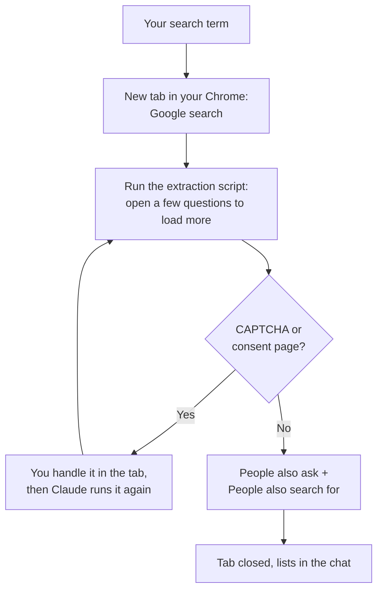

# SEO People Also Ask | Get Google's People Also Ask Questions and People Also Search For Terms with Claude

**Skill folder:** [`seo/seo-people-also-ask/`](../../seo/seo-people-also-ask/)

Give Claude a search term, such as *"get People also ask for emergency plumber"*, and it searches Google in your own Chrome browser through Claude in Chrome. It returns two lists: the "People also ask" questions and the "People also search for" terms. It clicks open a few questions first, because Google loads more questions each time one is opened. That usually turns 4 visible questions into 10 to 25.

The lists come straight from the results page, in Google's order and wording. Nothing is added or rewritten, which makes them a reliable starting point for blog topics, FAQ sections, and keyword research.

---

## What it's used for

- **Content ideas.** Real questions people ask about a topic, ready to become blog posts or sections of a page.
- **FAQ sections.** Questions to answer on a service or product page, in the words searchers use.
- **Keyword research.** Related searches Google connects to your term, including local and long-tail variations.
- **Checking a topic quickly.** See what Google thinks belongs alongside a search before writing about it.

## At a glance

| | |
|---|---|
| **Area** | [SEO](../../seo/) |
| **Works in** | Claude and Claude Code with Claude in Chrome connected. Other agents with a browser that can run JavaScript work too. |
| **Use it by** | Asking in plain English, such as *"People also ask for best crm for small business"*, or naming the skill |
| **You provide** | A search term, plus a language or country if you want results for somewhere else |
| **You get** | Two numbered lists in the chat, or a CSV if you ask for one |
| **Tools it uses** | Claude in Chrome (your Chrome browser) |
| **Version** | 1.0.0 |

---

## How it works



### Step 1: Search in your browser

Claude opens a new tab in your Chrome and searches Google for the term. Your own tabs are left alone. Because it's your browser, the results are the ones you'd see yourself, for your location.

### Step 2: Read the two sections

A small script runs on the results page. It finds the sections by their visible headings rather than Google's internal page code, which changes often. It clicks open up to 4 questions at a time so Google loads more, then reads both lists. If Google labels the bottom block "Related searches" instead of "People also search for", it reads that instead.

### Step 3: Report

You get both lists in Google's order, with the search, language, and date at the top. If Google didn't show one of the sections for your search, Claude says so instead of making something up.

### What's in the skill folder

| File | What it holds | When Claude reads it |
|---|---|---|
| `SKILL.md` | The steps and the output format | Every time the skill runs |
| `scripts/extract_serp_lists.js` | The script that opens questions and reads both lists | On every search |

---

## Setup

Plan on about 5 minutes.

### 1. Install the skill

**Claude (web and desktop apps):** Download this repo (**Code → Download ZIP**), unzip it, and zip the `seo/seo-people-also-ask` folder on its own. In Claude, go to **Customize → Skills**, click **+**, choose **Create skill → Upload a skill**, and upload the zip.

**Claude Code:** Copy the `seo-people-also-ask` folder into `~/.claude/skills/` for all your projects, or into `.claude/skills/` in one project.

**Skills CLI (Claude Code, Codex, Cursor, and other agents):**

```bash
npx skills add Width-ai/claude-marketing-skills --skill seo-people-also-ask --global
```

See [Installing a skill](../../README.md#installing-a-skill) for the Claude API and more options.

### 2. Connect Claude in Chrome

Install the Claude in Chrome extension in your Chrome browser and connect it to Claude. Keep Chrome open while the skill runs. The first time, Claude in Chrome may ask you to allow it on google.com.

### 3. Add a line to your AGENTS.md (optional)

If your project has an AGENTS.md or CLAUDE.md, add this line so your agent follows the rule even before the skill loads:

```markdown
- For People also ask or People also search for lists, use the seo-people-also-ask skill and report only what Google shows.
```

### 4. Test it

1. Start a new chat and send: *"Get People also ask and People also search for for emergency plumber"*
2. A new tab opens in your Chrome, searches Google, and closes again after a few seconds.
3. You should see two numbered lists. Usually that's 10 or more questions and around 8 related searches.

### 5. Make it yours

- **More or fewer questions:** ask for "just what shows" (no clicking) or "as many as possible" (more rounds of clicking).
- **Another country or language:** say it in the request, such as *"for the UK, in English"*. Claude adds Google's country and language settings to the search.
- **A file instead:** ask for a CSV and you get one row per entry.

---

## Using it

| Ask for | What you get |
|---|---|
| *"People also ask for best crm for small business"* | Both lists for that search |
| *"Just the People also search for terms for tankless water heater"* | Only the related searches list |
| *"Get as many People also ask questions as you can for roof repair cost"* | A longer question list, from more rounds of opening questions |
| *"Run these 5 keywords and give me a CSV"* | One search at a time, with a pause between each, then one CSV |
| *"People also ask for emergency plumber in the UK"* | Results for the UK instead of your own location |

Tips for better results:

- Results follow your location and Google account. For a clean, location-specific view, name the country in your request.
- Questions that appear after clicking are related to the ones above them, so the list drifts further from your term the more rounds you run.
- Google doesn't show both sections for every search. An empty list usually means Google didn't show one, not that something broke.

---

## Troubleshooting

| Symptom | Likely cause |
|---|---|
| Claude doesn't use the skill | The skill is turned off in **Customize → Skills**, or the request doesn't match its description. Name it directly: *"Use the seo-people-also-ask skill for ..."* |
| Claude says it can't reach the browser | Chrome is closed or Claude in Chrome isn't connected. Open Chrome, check the extension is connected, and ask again. |
| Claude stops and mentions a CAPTCHA | Google wants to confirm you're human. Solve it in the open tab and tell Claude to continue. Spacing out searches helps avoid this. |
| Claude stops at a "Before you continue" page | Google's cookie consent screen. Choose an option in the tab and tell Claude to continue. |
| One list is empty | Google didn't show that section for this search. Try a broader or more question-like term. |
| Results look local to you | That's Google using your location. Name a country in the request for another market. |
