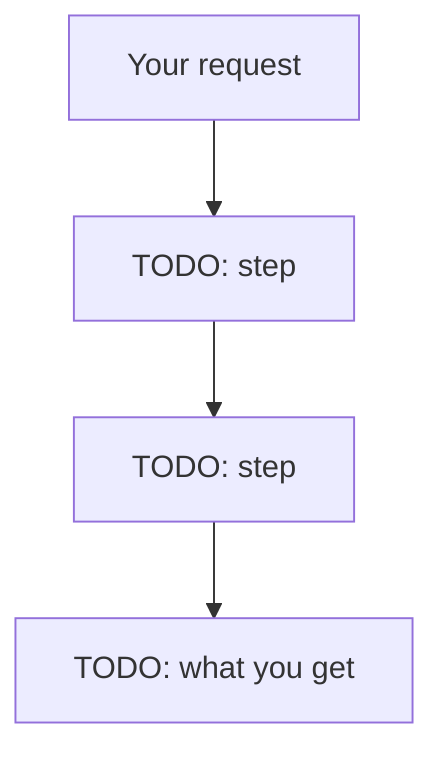

<!--
TODO: Delete this comment before publishing. Replace every TODO: below, and delete optional steps that don't apply.

Writing rules:
- Write for a marketer, not a developer. Plain words, short sentences, concrete examples.
- No em dashes. Use a comma, colon, parentheses, or two sentences.
- Put example requests in italics, written the way someone would really type them.
- Everything here must match SKILL.md. Change both in the same commit.
- Keep the headings below, in this order. The validator checks them.
-->

# TODO: Skill Title | TODO: What It Does, in the Words People Search For

**Skill folder:** [`TODO-area/TODO-skill-name/`](../../TODO-area/TODO-skill-name/)

TODO: Two or three sentences. What the skill does in plain English, one example request in italics, such as *"write a content brief for best crm for small business"*, and what you get back. Then say what the skill uses to do the work, such as web search, a connector, or the rules and examples in its reference files.

TODO: Optional second paragraph on what you get with the skill that you wouldn't get by asking Claude without it: the rules it follows, the checks it runs, or the examples it learns from.

---

## What it's used for

- **TODO: The job, in bold.** One or two sentences on the situation and the result.
- **TODO: Another job.** One or two sentences.
- **TODO: Another job.** One or two sentences.

## At a glance

| | |
|---|---|
| **Area** | [TODO: Area name](../../TODO-area/) |
| **Works in** | Claude (web and desktop apps), Claude Code, the Claude API, and other agents that support Agent Skills |
| **Use it by** | Asking in plain English, such as *"TODO: example request"*, or naming the skill |
| **You provide** | TODO: what you bring, such as a keyword, a URL, a draft, or a CSV export |
| **You get** | TODO: the output and its format, such as a brief in the chat or a Markdown file |
| **Tools it uses** | TODO: web search, code execution, a connector such as Ahrefs, or None |
| **Version** | TODO: 1.0.0 (must match `metadata.version` in SKILL.md) |

---

## How it works



### Step 1: TODO

TODO: What Claude does in this step and why it matters. Use a table when there's a list of rules, checks, or fields.

### Step 2: TODO

TODO

### Step 3: TODO

TODO

### What's in the skill folder

| File | What it holds | When Claude reads it |
|---|---|---|
| `SKILL.md` | The instructions: when to use the skill, the steps, and the output format | Every time the skill runs |
| `references/TODO.md` | TODO | TODO |

---

## Setup

Plan on about TODO minutes.

### 1. Install the skill

**Claude (web and desktop apps):** Download this repo (**Code → Download ZIP**), unzip it, and zip the `TODO-area/TODO-skill-name` folder on its own. In Claude, go to **Customize → Skills**, click **+**, choose **Create skill → Upload a skill**, and upload the zip. Code execution must be on in **Settings → Capabilities**.

**Claude Code:** Copy the `TODO-skill-name` folder into `~/.claude/skills/` for all your projects, or into `.claude/skills/` in one project.

**Skills CLI (Claude Code, Codex, Cursor, and other agents):**

```bash
npx skills add Width-ai/claude-marketing-skills --skill TODO-skill-name --global
```

See [Installing a skill](../../README.md#installing-a-skill) for the Claude API and more options.

### 2. TODO: Connect tools (optional step, delete it if the skill needs none)

TODO: Which tool to turn on or connect, where, and what the skill does without it.

### 3. TODO: Add your business details (optional step, delete it if the skill needs none)

TODO: What business facts the skill works best with and how to provide them, such as a project file, an attachment, or a message at the start of the chat.

### 4. TODO: Add a line to your AGENTS.md (optional step, delete it if the skill needs none)

If your project has an AGENTS.md or CLAUDE.md, add this line so your agent follows the rule even before the skill loads:

```markdown
- TODO: one rule, about this skill only
```

### 5. Test it

1. Start a new chat and send: *"TODO: a small, realistic request"*
2. TODO: What should happen, and roughly how long it takes.
3. TODO: One thing to check that proves it worked.

### 6. Make it yours

- **TODO: Change something:** edit `references/TODO.md` to ...
- **TODO: Change something else:** ...

---

## Using it

| Ask for | What you get |
|---|---|
| *"TODO"* | TODO |
| *"TODO"* | TODO |
| *"TODO"* | TODO |

TODO: Two to four tips for better results, such as what context to include or how to ask for a revision.

---

## Troubleshooting

| Symptom | Likely cause |
|---|---|
| Claude doesn't use the skill | The skill is turned off in **Customize → Skills**, or the request doesn't match its description. Name it directly: *"Use the TODO-skill-name skill to ..."* |
| TODO | TODO |
| TODO | TODO |
